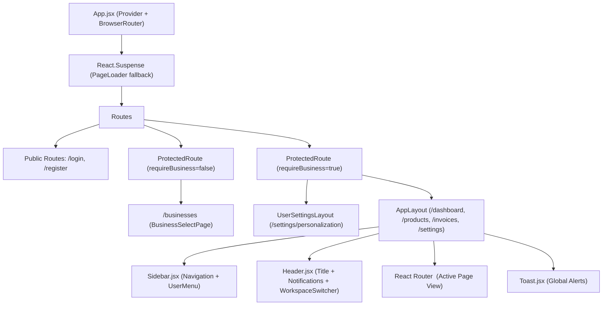
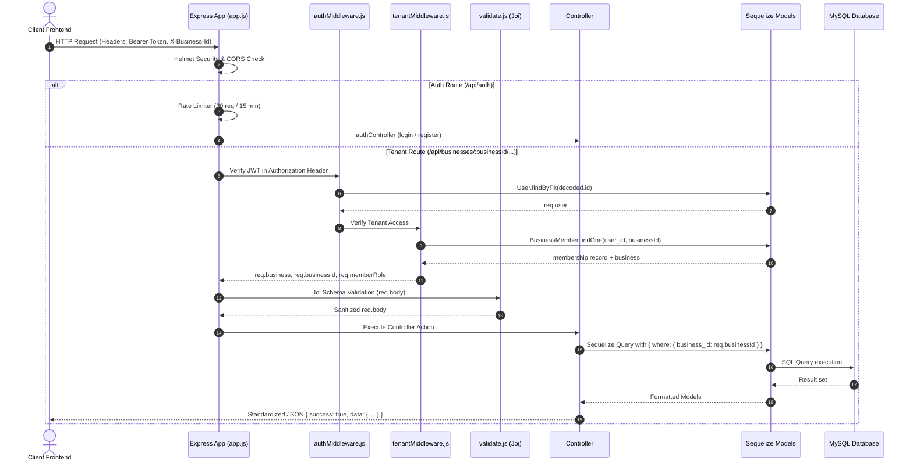
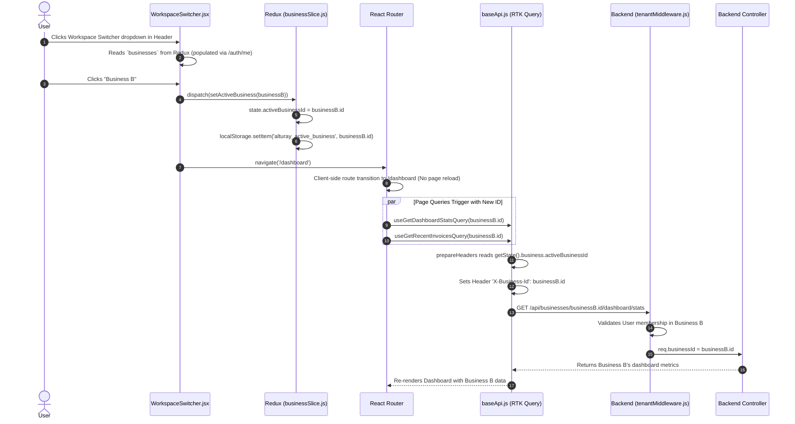
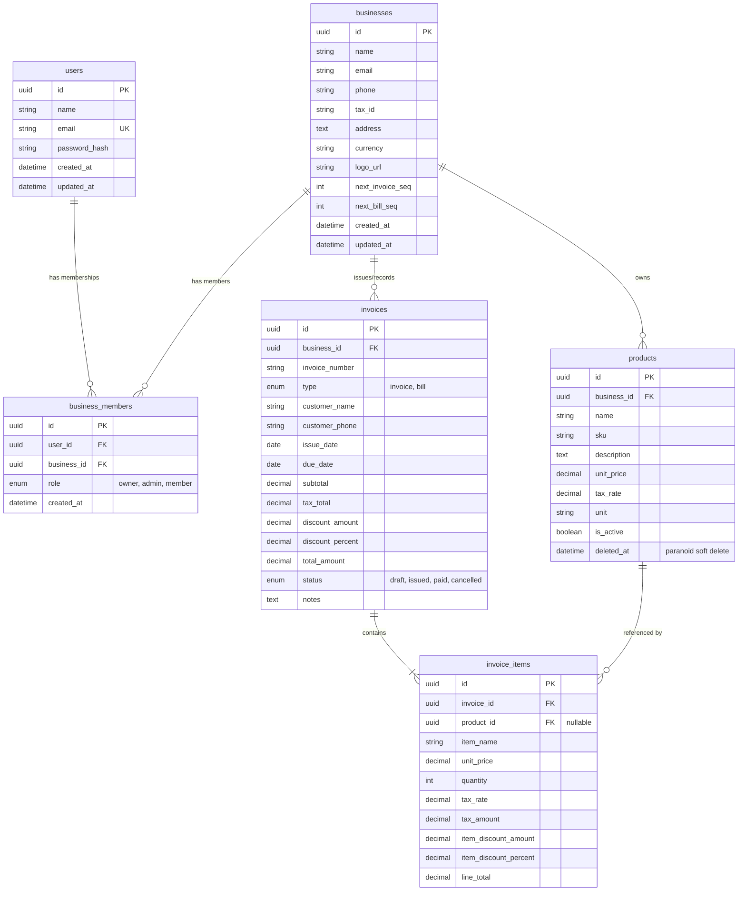

# Alturay Platform — Comprehensive Codebase Architecture & Technical Report

**Document Version:** 1.0.0  
**Generated On:** October 25, 2026  
**Scope:** Full-stack inspection of `/client` (Frontend) and `/server` (Backend)  
**Deliverable File:** `ALTURAY_CODEBASE_ANALYSIS.md`  

---

## Table of Contents
1. [Executive Summary](#1-executive-summary)
2. [Actual Repository Structure](#2-actual-repository-structure)
3. [Technology Stack](#3-technology-stack)
4. [Frontend Architecture](#4-frontend-architecture)
5. [Backend Architecture](#5-backend-architecture)
6. [Authentication and User Identity](#6-authentication-and-user-identity)
7. [Business and Workspace Architecture](#7-business-and-workspace-architecture)
8. [Complete Business-Switching Flow](#8-complete-business-switching-flow)
9. [Database Models and Relationships](#9-database-models-and-relationships)
10. [Business-Level Authorization and Data Isolation](#10-business-level-authorization-and-data-isolation)
11. [Existing Business Modules](#11-existing-business-modules)
12. [API Endpoint Inventory](#12-api-endpoint-inventory)
13. [Dashboard Data Availability Matrix](#13-dashboard-data-availability-matrix)
14. [Existing Theme and Design System](#14-existing-theme-and-design-system)
15. [Installed Skills and Development Conventions](#15-installed-skills-and-development-conventions)
16. [Testing and Validation](#16-testing-and-validation)
17. [Technical Risks and Missing Features](#17-technical-risks-and-missing-features)
18. [Recommended Dashboard Implementation Plan](#18-recommended-dashboard-implementation-plan)
19. [Questions Requiring Product Owner Decisions](#19-questions-requiring-product-owner-decisions)
20. [Appendix: Important File Paths, Functions, and Line References](#20-appendix-important-file-paths-functions-and-line-references)

---

## 1. Executive Summary

**Alturay** is a multi-tenant business management and billing platform designed to allow a single user account to create, manage, and switch between multiple distinct business entities. 

### Key Architectural Findings:
1. **Multi-Tenancy Foundation:** The system implements a true relational multi-tenant architecture. A `users` record represents an identity, which is associated with multiple `businesses` via a `business_members` join table. Tenancy is enforced at the backend through `tenantMiddleware.js`, which validates that the authenticated user belongs to the requested business before allowing access to resources (`products`, `invoices`, `dashboard`).
2. **Business Switching Implementation:** The workspace switcher in the header ([`WorkspaceSwitcher.jsx`](file:///Users/devyashrasela/Data/Web/Projects/Alturay/client/src/components/layout/WorkspaceSwitcher.jsx)) updates the active tenant in Redux (`businessSlice.js`) and persists the active business ID in `localStorage` (`alturay_active_business`). When switching, the front-end navigates to `/dashboard` and RTK Query triggers fresh queries for the new business ID while attaching the `X-Business-Id` header to every outgoing request.
3. **Dual Invoice/Bill Entity Pattern:** Customer invoices and vendor bills are stored in the same database table (`invoices`) distinguished by an `ENUM('invoice', 'bill')` discriminator column. Both share identical line items, sequence generators (`INV-001` vs `BILL-001`), tax calculation engines, and status workflows (`draft`, `issued`, `paid`, `cancelled`).
4. **Denormalized Contacts:** The application currently lacks separate `customers` and `suppliers` tables. Customer/vendor information is embedded directly as string fields (`customer_name`, `customer_phone`) on the `invoices` table.
5. **Inventory Depth & Missing Entities:** While product catalog management exists (pricing, SKU, tax rate, units), inventory tracking is currently missing. There are **no stock quantities**, **no low-stock thresholds**, **no inventory ledger/movements**, **no dedicated employee/staff profile management** beyond basic membership roles, and **no activity/audit log**.

---

## 2. Actual Repository Structure

```
Alturay/
├── .agents/                               # Custom AI agent skills and guidelines
│   └── skills/
│       ├── vercel-composition-patterns/   # Component composition rules (React 19)
│       ├── vercel-react-best-practices/   # React performance & optimization guidelines
│       └── web-design-guidelines/         # Accessibility & interface standards
├── .git/                                  # Git repository
├── .gitignore                             # Ignored root artifacts
├── package.json                           # Root scripts (concurrent dev orchestration)
├── skills-lock.json                       # Agent skills dependency lockfile
├── README.md                              # Root project descriptor
├── client/                                # React 19 Frontend Application
│   ├── .env                               # Local frontend env configuration
│   ├── .env.example                       # Example frontend environment variables
│   ├── .env.production                    # Production frontend environment variables
│   ├── .oxlintrc.json                     # Oxlint configuration
│   ├── index.html                         # SPA HTML entry point & favicon setup
│   ├── package.json                       # Frontend dependencies & scripts
│   ├── vite.config.js                     # Vite build & reverse-proxy configuration
│   ├── public/                            # Static branding assets, icons, fonts
│   │   ├── alturay_light.png              # Primary brand mark
│   │   ├── favicon.ico / favicon.svg      # Favicons
│   │   └── fonts/                         # Self-hosted Mona Sans font binary (woff2)
│   └── src/                               # Application source code
│       ├── App.jsx                        # Root routes, provider assembly, Suspense shells
│       ├── main.jsx                       # DOM mount entry point
│       ├── index.css                      # Design system: tokens, utilities, and components
│       ├── components/
│       │   ├── auth/                      # AuthLayout, PasswordInput
│       │   ├── layout/                    # AppLayout, Header, Sidebar, WorkspaceSwitcher, UserMenu
│       │   ├── settings/                  # UserSettingsLayout, SettingsSidebar
│       │   └── ui/                        # Primitives: Button, Card, Modal, Input, Badge, BarChart, Toast
│       ├── pages/
│       │   ├── Auth/                      # LoginPage, RegisterPage
│       │   ├── Businesses/                # BusinessSelectPage (Tenant onboarding/selection)
│       │   ├── Dashboard/                 # DashboardPage (KPIs, Charts, Recent Invoices)
│       │   ├── Invoices/                  # InvoicesPage, CreateInvoicePage, InvoiceDetailPage
│       │   ├── Products/                  # ProductsPage (Product catalog CRUD & modals)
│       │   └── Settings/                  # BusinessSettingsPage, PersonalizationPage
│       ├── routes/
│       │   └── ProtectedRoute.jsx         # Two-tier route guards (Auth & Business context)
│       ├── store/
│       │   ├── index.js                   # Redux store & RTK Query middleware config
│       │   ├── api/                       # RTK Query slices (baseApi, authApi, businessApi, invoiceApi, productApi, dashboardApi)
│       │   └── slices/                    # Redux slices (authSlice, businessSlice, themeSlice, uiSlice)
│       └── utils/                         # Calculators, formatters, and security error sanitizers
└── server/                                # Node.js / Express Backend Application
    ├── .env                               # Local backend database & JWT secrets
    ├── .env.example                       # Example server environment configuration
    ├── .sequelizerc                       # Sequelize CLI directory mapping
    ├── package.json                       # Backend dependencies & migration scripts
    ├── server.js                          # Server bootloader & database sync
    └── src/
        ├── app.js                         # Express application middleware assembly
        ├── config/                        # Config loader (`index.js`, `database.js`)
        ├── controllers/                   # auth, business, dashboard, invoice, product controllers
        ├── middlewares/                   # authMiddleware, tenantMiddleware, errorHandler, validate
        ├── models/                        # User, Business, BusinessMember, Product, Invoice, InvoiceItem
        ├── routes/                        # Route modules mounted under `/api`
        ├── services/                      # invoiceCalculator.js, pdfGeneratorService.js
        ├── utils/                         # Winston logger (`logger.js`)
        └── validators/                    # Joi validation schemas for all requests
```

---

## 3. Technology Stack

### Frontend
- **Runtime & UI Library:** React `19.2.8` & React DOM `19.2.8`
- **Application Bundler:** Vite `8.3.0` (`@vitejs/plugin-react` `6.1.1`)
- **Routing Engine:** React Router DOM `7.18.4`
- **State Management:** Redux Toolkit `2.13.0` & React-Redux `9.3.0`
- **Data Fetching & Cache:** RTK Query (`@reduxjs/toolkit/query/react`)
- **Styling Architecture:** Vanilla CSS Token Engine (`index.css` ~4,500 lines) with self-hosted **Mona Sans** font
- **Iconography:** Lucide React `1.55.0`
- **Date Picking:** React Datepicker `9.1.0`
- **Linter & Test Runner:** Oxlint `1.81.0` & Node.js Native Test Runner (`node:test`)

### Backend
- **Framework & Server:** Node.js with Express `4.21.2`
- **Database Engine:** MySQL (via `mysql2` `3.12.0`)
- **ORM:** Sequelize `6.37.5` & Sequelize CLI `6.6.2`
- **Authentication:** JSON Web Tokens (`jsonwebtoken` `9.0.2`) & Password Hashing (`bcryptjs` `2.4.3`)
- **Security & Headers:** Helmet `8.3.0`, CORS `2.8.5`, Express Rate Limit `7.5.0`
- **Validation:** Joi `17.13.3`
- **Document Generation:** PDFKit `0.16.0` (server-side stream generation)
- **Logging:** Winston `3.17.0` & Morgan `1.10.0`

---

## 4. Frontend Architecture

### 4.1 Component Hierarchy & Layout Structure
The frontend application entry point is [`client/src/main.jsx`](file:///Users/devyashrasela/Data/Web/Projects/Alturay/client/src/main.jsx), which renders [`client/src/App.jsx`](file:///Users/devyashrasela/Data/Web/Projects/Alturay/client/src/App.jsx) wrapped in Redux `<Provider store={store}>` and React Router `<BrowserRouter>`.



### 4.2 Reusable UI Component Library
The UI library in [`client/src/components/ui`](file:///Users/devyashrasela/Data/Web/Projects/Alturay/client/src/components/ui) provides reusable primitives:
- **`Button`**: Supports `variant="primary" | "secondary" | "outline-primary" | "ghost"`, sizes `sm | md | lg`, and built-in loading spinner states.
- **`Card` & `StatCard`**: Elevated surface containers with support for metrics, icons, subtitles, and trend chips.
- **`Modal` & `ConfirmDialog`**: Accessible React Portals with backdrop blur, `Escape` key capture, body-scroll lock, and accessible keyboard focus.
- **`BarChart`**: A lightweight, dependency-free CSS/SVG vertical bar chart designed specifically for monthly revenue comparisons with tooltips and responsive scaling.
- **`StatusBadge`**: Semantic status tags (`draft`, `issued`, `paid`, `cancelled`, `overdue`) displaying color-matched dots and surface tints.
- **`Pagination`**: Full server-pagination bar with page-jumping and total count calculations.
- **`Toast`**: A global floating notification queue tied to Redux `uiSlice.toasts`.

---

## 5. Backend Architecture

### 5.1 Request Lifecycle & Middleware Pipeline
All API requests entering the Express backend follow this sequence:



### 5.2 Server Entry Point & Model Synchronization
- [`server/server.js`](file:///Users/devyashrasela/Data/Web/Projects/Alturay/server/server.js): Tests connection via `sequelize.authenticate()`.
- **Development Sync:** In development mode (`NODE_ENV === 'development'`), it executes `sequelize.sync({ alter: true })`.
- **Missing Migrations:** The backend does **not** have migration scripts in `server/src/migrations/`. Production relies on schema sync.

---

## 6. Authentication and User Identity

### 6.1 Authentication Mechanism
- **Algorithm:** Signed JSON Web Tokens (HMAC-SHA256) containing `{ id: user.id, email: user.email }`.
- **Expiration:** Configurable via `JWT_EXPIRES_IN` (defaults to 7 days).
- **Passwords:** Hashed with `bcryptjs` using a salt factor of 12.

### 6.2 Token and Session Management
- **Frontend Storage:** Stored in browser `localStorage` under the key `alturay_token`.
- **Header Injection:** Attached automatically to every HTTP request in `baseApi.js` via `prepareHeaders`:
  ```javascript
  const token = getState().auth.token;
  if (token) headers.set('Authorization', `Bearer ${token}`);
  ```
- **Session Restoration:** On initial load, `authSlice.js` checks `localStorage.getItem('alturay_token')`. If present, `isAuthenticated` is initialized to `true`.
- **Identity Fetching:** Once authenticated, [`AppLayout.jsx`](file:///Users/devyashrasela/Data/Web/Projects/Alturay/client/src/components/layout/AppLayout.jsx) triggers `useGetMeQuery()` calling `GET /api/auth/me`. The response returns the `user` object along with all joined businesses and roles.
- **Logout Behavior:** Dispatching `logout()` clears `state.auth.user`, `state.auth.token`, and purges both `alturay_token` and `alturay_active_business` from `localStorage`.

---

## 7. Business and Workspace Architecture

### 7.1 Multi-Tenant Concept: Account vs. Business Membership
- A **User Account** (`users` table) is a global entity with credentials (`email`, `password_hash`).
- A **Business** (`businesses` table) represents a workspace containing products, invoices, and sequence numbers.
- A **Business Member** (`business_members` table) represents the many-to-many relationship linking a User to a Business with a specific `role` (`'owner'`, `'admin'`, `'member'`).
- A user can belong to multiple businesses with different roles (e.g., `'owner'` in Business A, `'member'` in Business B).

### 7.2 Active Business State Storage
The active business is tracked in four places:
1. **Redux State (`state.business.activeBusinessId`):** Primary reactive reference for components.
2. **Redux State (`state.business.activeBusiness`):** Full object metadata (`id`, `name`, `currency`, `role`, `logo_url`).
3. **Browser Storage (`localStorage.getItem('alturay_active_business')`):** Persists the selected business ID across page reloads.
4. **Network Request Header (`X-Business-Id`):** Injected into every outbound HTTP request by `baseApi.js`.

---

## 8. Complete Business-Switching Flow

Here is the exact step-by-step trace of what happens when a user switches businesses:



### Detailed Trace Answers:
1. **Where implemented:** [`client/src/components/layout/WorkspaceSwitcher.jsx`](file:///Users/devyashrasela/Data/Web/Projects/Alturay/client/src/components/layout/WorkspaceSwitcher.jsx).
2. **Rendered by:** [`client/src/components/layout/Header.jsx`](file:///Users/devyashrasela/Data/Web/Projects/Alturay/client/src/components/layout/Header.jsx) at line 167.
3. **When clicked:** Opens dropdown listing businesses from `state.business.businesses`. Clicking a business invokes `handleSwitch(biz)`:
   ```javascript
   const handleSwitch = (biz) => {
     setOpen(false);
     dispatch(setActiveBusiness(biz));
     navigate('/dashboard');
   };
   ```
4. **List source:** Loaded during `useGetMeQuery()` in [`AppLayout.jsx`](file:///Users/devyashrasela/Data/Web/Projects/Alturay/client/src/components/layout/AppLayout.jsx) lines 27-28 and saved to Redux.
5. **Identification:** Identified by UUID string (`biz.id`).
6. **Storage:** In Redux `businessSlice` and `localStorage` (`alturay_active_business`).
7. **URL Updates:** Navigates to `/dashboard`. The URL does **not** include the business ID.
8. **Reload vs. Transition:** Client-side React transition. No page reload occurs.
9. **API Request Updates:** In [`baseApi.js`](file:///Users/devyashrasela/Data/Web/Projects/Alturay/client/src/store/api/baseApi.js), `prepareHeaders` reads `getState().business.activeBusinessId` and adds `X-Business-Id`. Additionally, pages pass `activeBusinessId` directly into query hook parameters.
10. **Cache Isolation:** RTK Query keys cache entries by query arguments. Because endpoints take `businessId` as an argument (`/businesses/${businessId}/...`), query caches for Business A and Business B are stored separately.
11. **In-Flight Requests:** If an API call for Business A is in-flight when switching to Business B, RTK Query unsubscribes from Business A's endpoint and initiates Business B's request.
12. **Unavailable or Deleted Business:** On refresh, [`AppLayout.jsx`](file:///Users/devyashrasela/Data/Web/Projects/Alturay/client/src/components/layout/AppLayout.jsx) line 31 checks if `activeBusinessId` matches any business in `user.businesses`. If not found, it defaults to `user.businesses[0]`. If `user.businesses` is empty, it redirects to `/businesses`.
13. **Browser Refresh Persistence:** Yes, restored from `localStorage.getItem('alturay_active_business')`.
14. **User Switch (Logout/Login):** Logout clears both `alturay_token` and `alturay_active_business`. A subsequent user login starts clean without old tenant leaks.

---

## 9. Database Models and Relationships

The backend uses 6 Sequelize models located in [`server/src/models`](file:///Users/devyashrasela/Data/Web/Projects/Alturay/server/src/models):



### Models Documented:
1. **`User` (`users` table):** Primary user identity. Unique constraint on `email`.
2. **`Business` (`businesses` table):** Business entity. Holds sequential counters `next_invoice_seq` and `next_bill_seq`.
3. **`BusinessMember` (`business_members` table):** Junction table. Composite unique index on `['user_id', 'business_id']`.
4. **`Product` (`products` table):** Catalog item. Contains `business_id`. Uses `paranoid: true` (soft deletes via `deleted_at`).
5. **`Invoice` (`invoices` table):** Unified invoice and bill store. Composite unique index on `['business_id', 'invoice_number']`.
6. **`InvoiceItem` (`invoice_items` table):** Line items. Links to `invoice_id` with optional `product_id`.

### Models NOT Found in the Codebase:
- ❌ **`Employee` / `Staff`:** Missing. Employees exist only as user memberships in `business_members`.
- ❌ **`Customer` / `Client`:** Missing. Embedded directly into `invoices.customer_name`.
- ❌ **`Supplier` / `Vendor`:** Missing. Embedded into `invoices.customer_name` when `type = 'bill'`.
- ❌ **`InventoryMovement` / `Stock`:** Missing. No inventory tracking or quantity fields exist on `Product`.
- ❌ **`Payment` / `Transaction`:** Missing. Payments are not tracked as ledger entries; only `invoice.status = 'paid'`.
- ❌ **`ActivityLog` / `AuditLog`:** Missing. No activity recording table exists.

---

## 10. Business-Level Authorization and Data Isolation

### 10.1 Tenancy Enforcement
- **Header & Param Resolution:** [`server/src/middlewares/tenantMiddleware.js`](file:///Users/devyashrasela/Data/Web/Projects/Alturay/server/src/middlewares/tenantMiddleware.js) extracts the target business ID from `req.params.businessId` or `req.headers['x-business-id']`.
- **Membership Verification:** It queries `BusinessMember` for a match between `req.user.id` and `businessId`. If no membership exists, it returns HTTP `403 Forbidden` (`FORBIDDEN: You do not have access to this business`).
- **Database Query Scoping:** Every controller method explicitly scopes queries with `{ business_id: req.businessId }`:
  - `productController.js`: `where: { id: req.params.productId, business_id: req.businessId }`
  - `invoiceController.js`: `where: { id: req.params.invoiceId, business_id: req.businessId }`
  - `dashboardController.js`: `where: { business_id: req.businessId }`

### 10.2 Security Vulnerabilities & Isolation Gaps
1. **Lack of Role-Based Permissions (RBAC):**  
   While `BusinessMember` defines `role: ENUM('owner', 'admin', 'member')` and `tenantMiddleware` sets `req.memberRole`, **no controllers check `req.memberRole`**. A user with the `'member'` role has full permission to edit business settings, create/delete products, and create/cancel invoices.
2. **Missing 403 Response Interceptor on Frontend:**  
   If a user's membership in a business is revoked while they are active, subsequent API requests receive HTTP 403. The frontend does not have an RTK Query middleware interceptor to catch 403s, clear `alturay_active_business`, and redirect the user back to `/businesses`.

---

## 11. Existing Business Modules

### 11.1 Inventory Management
- **Status:** **Catalog-Only (No Stock Tracking)**
- **Supported Operations:** Create product, list products (with search and pagination), update product, soft delete product (`paranoid: true`).
- **Fields Present:** `name`, `sku`, `unit_price`, `tax_rate`, `unit`, `description`, `is_active`.
- **Missing Requirements:** No `stock_quantity`, no `low_stock_threshold`, no stock in/out movement logs. **Low stock items and inventory valuation cannot be calculated from existing database fields.**

### 11.2 Sales and Revenue
- **Status:** **Available via Invoices**
- **Definition:** Revenue is aggregated from `invoices` where `type = 'invoice'` and `status IN ('issued', 'paid')`.
- **Discounts & Taxes:** Supports per-line item discounts (`item_discount_amount`, `item_discount_percent`), line tax rates, and whole-invoice discounts (`discount_amount`, `discount_percent`).
- **Available Endpoint:** `GET /businesses/:businessId/dashboard/stats` calculates:
  - `total_revenue`: Total sum of all issued and paid invoices.
  - `monthly_series`: Continuous 6-month array of monthly revenue totals.

### 11.3 Invoices and Bills
- **Status:** **Fully Implemented**
- **Dual Entity:** Managed via `Invoice` model using `type: 'invoice'` vs `type: 'bill'`.
- **Atomic Numbering:** Handled via database transactions (`sequelize.transaction()`) with row-level locks on `Business` table (`{ lock: true }`) to increment `next_invoice_seq` / `next_bill_seq`.
- **Statuses:** `draft`, `issued`, `paid`, `cancelled`.
- **Overdue Handling:** Calculated dynamically by evaluating `status === 'issued' && due_date < today`.
- **PDF Export:** Full PDF generation streaming via PDFKit (`GET /businesses/:businessId/invoices/:invoiceId/pdf`).

### 11.4 Employees and Memberships
- **Status:** **Partially Implemented (Schema only, no UI/API management)**
- **Capabilities:** Database links users via `business_members` with roles.
- **Missing Requirements:** There are no endpoints to list, invite, update, or remove members in a business. The creator is automatically assigned as `'owner'`, but no other employees can be onboarded through the API.

### 11.5 Customers and Suppliers
- **Status:** **Denormalized Only**
- **Implementation:** No dedicated tables. Names and phone numbers are stored as plain text columns on each invoice.

### 11.6 Notifications and Activities
- **Status:** **Derived / No Audit Table**
- **Notification Bell:** Evaluated on the client by filtering recent invoices for unpaid overdue records.
- **Activity Log:** Does not exist. No event history is recorded.

---

## 12. API Endpoint Inventory

| Method | Endpoint Path | Purpose | Auth Required | Tenant Verification | Request Parameters | Response Structure |
| :--- | :--- | :--- | :---: | :---: | :--- | :--- |
| `POST` | `/api/auth/register` | User account registration | No | None | Body: `name`, `email`, `password` | `{ success: true, data: { user, token } }` |
| `POST` | `/api/auth/login` | User login & JWT issuance | No | None | Body: `email`, `password` | `{ success: true, data: { user, token } }` |
| `GET` | `/api/auth/me` | Fetch profile & businesses | Yes | None | None | `{ success: true, data: { user: { id, name, email, businesses[] } } }` |
| `GET` | `/api/businesses` | List user's businesses | Yes | None (User-scoped) | None | `{ success: true, data: { businesses: [...] } }` |
| `POST` | `/api/businesses` | Create business & become owner| Yes | None (Creates tenant) | Body: `name`, `currency`, `email`, `phone`, `tax_id`, `address` | `{ success: true, data: { business } }` |
| `GET` | `/api/businesses/:businessId` | Get business profile | Yes | `tenantMiddleware` | Param: `businessId` | `{ success: true, data: { business } }` |
| `PUT` | `/api/businesses/:businessId` | Update business profile | Yes | `tenantMiddleware` | Param: `businessId`, Body: business fields | `{ success: true, data: { business } }` |
| `GET` | `/api/businesses/:businessId/dashboard/stats` | Dashboard statistics & series | Yes | `tenantMiddleware` | Param: `businessId` | `{ success: true, data: { stats: { total_revenue, monthly_series[], status_counts, ... } } }` |
| `GET` | `/api/businesses/:businessId/dashboard/recent` | Recent invoices & bills | Yes | `tenantMiddleware` | Param: `businessId` | `{ success: true, data: { invoices: [...] } }` |
| `GET` | `/api/businesses/:businessId/products` | Paginated product catalog | Yes | `tenantMiddleware` | Query: `page`, `limit`, `search` | `{ success: true, data: { products: [...] }, meta: { total, totalPages } }` |
| `POST` | `/api/businesses/:businessId/products` | Create product in catalog | Yes | `tenantMiddleware` | Body: `name`, `unit_price`, `sku`, `tax_rate`, `unit`, `description` | `{ success: true, data: { product } }` |
| `GET` | `/api/businesses/:businessId/products/:productId`| Get single product | Yes | `tenantMiddleware` | Params: `businessId`, `productId` | `{ success: true, data: { product } }` |
| `PUT` | `/api/businesses/:businessId/products/:productId`| Update product details | Yes | `tenantMiddleware` | Params: `businessId`, `productId`, Body: fields | `{ success: true, data: { product } }` |
| `DELETE`| `/api/businesses/:businessId/products/:productId`| Soft delete product | Yes | `tenantMiddleware` | Params: `businessId`, `productId` | `{ success: true, data: { message } }` |
| `GET` | `/api/businesses/:businessId/invoices` | Paginated invoices/bills | Yes | `tenantMiddleware` | Query: `page`, `limit`, `search`, `type`, `status` | `{ success: true, data: { invoices: [...] }, meta: { total, totalPages } }` |
| `POST` | `/api/businesses/:businessId/invoices` | Create invoice or bill | Yes | `tenantMiddleware` | Body: `type`, `customer_name`, `issue_date`, `items[]`, etc. | `{ success: true, data: { invoice } }` |
| `GET` | `/api/businesses/:businessId/invoices/:invoiceId`| Get invoice with items | Yes | `tenantMiddleware` | Params: `businessId`, `invoiceId` | `{ success: true, data: { invoice } }` |
| `PUT` | `/api/businesses/:businessId/invoices/:invoiceId`| Edit draft invoice | Yes | `tenantMiddleware` | Params: `businessId`, `invoiceId`, Body: fields | `{ success: true, data: { invoice } }` |
| `PATCH`| `/api/businesses/:businessId/invoices/:invoiceId/status`| Transition status | Yes | `tenantMiddleware` | Body: `status` ('draft', 'issued', 'paid', 'cancelled') | `{ success: true, data: { invoice } }` |
| `GET` | `/api/businesses/:businessId/invoices/:invoiceId/pdf`| Stream PDF document | Yes | `tenantMiddleware` | Params: `businessId`, `invoiceId` | Binary Application/PDF stream |

---

## 13. Dashboard Data Availability Matrix

| Proposed Dashboard Component | Availability Status | Source Model / Fields | Existing API Endpoint | Missing Requirements / Work Needed |
| :--- | :---: | :--- | :--- | :--- |
| **Header: User Greeting** | **Available** | `User.name` | `GET /api/auth/me` | Fully available via Redux `state.auth.user.name`. |
| **Header: Business Switcher** | **Available** | `BusinessMember` $\rightarrow$ `Business` | `GET /api/auth/me` | Fully available via `WorkspaceSwitcher.jsx`. |
| **Header: Date Range Selector** | **Partially Available** | `Invoice.issue_date` | `GET .../dashboard/stats` | Endpoint currently hardcodes last 6 months; needs query params `startDate` & `endDate`. |
| **Header: Notifications Icon** | **Available** | `Invoice.due_date`, `status` | `GET .../dashboard/recent` | Handled client-side by checking overdue invoices. |
| **KPI: Total Revenue** | **Available** | `Invoice.total_amount` | `GET .../dashboard/stats` | Returned directly as `stats.total_revenue`. |
| **KPI: Total Products** | **Available** | `Product.count()` | `GET .../dashboard/stats` | Returned directly as `stats.total_products`. |
| **KPI: Total Employees** | **Partially Available** | `BusinessMember.count()` | None | Backend must add `BusinessMember.count({ where: { business_id } })` to stats endpoint. |
| **KPI: Low Stock Items** | **Missing** | None | None | `Product` model has no stock quantities or threshold fields. Cannot be calculated. |
| **Sales Overview (Chart)** | **Available** | `Invoice.total_amount` by month | `GET .../dashboard/stats` | Returned as `stats.monthly_series` (6 months). Needs date filter support. |
| **Invoice & Bill Status Overview** | **Available** | `Invoice.status`, `type` | `GET .../dashboard/stats` | Returned as `status_counts`, `outstanding_receivable`, and `outstanding_payable`. |
| **Recent Invoices & Bills** | **Available** | `Invoice` table | `GET .../dashboard/recent` | Returns 10 most recent invoices with customer names, dates, amounts, and statuses. |
| **Recent Activities** | **Missing** | None | None | No activity log model exists. Needs a new `activity_logs` table and logging service. |
| **Inventory Alerts** | **Missing** | None | None | No inventory/stock tracking data exists in database. |

---

## 14. Existing Theme and Design System

The application uses a custom-built design system defined in [`client/src/index.css`](file:///Users/devyashrasela/Data/Web/Projects/Alturay/client/src/index.css) (~4,500 lines).

### Key Design Tokens:
- **Default Theme:** Dark Mode (`color-scheme: dark`) with Light Mode remapping via `[data-theme="light"]`.
- **Surfaces:**
  - Background Main: `--color-bg-main` (`#121212` in Dark, `#F7F7F8` in Light)
  - Card Surface: `--color-bg-card` (`#1E1E1E` in Dark, `#FFFFFF` in Light)
  - Secondary/Sidebar Surface: `--color-bg-secondary` (`#171717` in Dark, `#FFFFFF` in Light)
  - Input Surface: `--color-bg-input` (`#262626` in Dark, `#F5F5F7` in Light)
- **Brand Accent:**
  - Primary Blue: `--color-primary` (`#2563EB`)
  - Hover: `--color-primary-hover` (`#1D4ED8`)
  - Accent Ring: `--color-primary-ring` (`rgba(37, 99, 235, 0.32)`)
- **Semantic Colors:**
  - Success: `--color-success` (`#4ADE80`)
  - Warning/Overdue: `--color-warning` (`#FBBF24`), Strong: `--color-warning-strong` (`#FCD34D`)
  - Danger/Cancel: `--color-danger` (`#F87171`)
  - Info: `--color-info` (`#60A5FA`)
- **Typography:** Self-hosted `Mona Sans` font (`--font-family: 'Mona Sans', ...`).
- **Sidebar Dimensions:** `--sidebar-width: 280px`, `--sidebar-collapsed-width: 52px`, `--header-height: 64px`.

---

## 15. Installed Skills and Development Conventions

The repository has 3 skills installed under [`.agents/skills/`](file:///Users/devyashrasela/Data/Web/Projects/Alturay/.agents/skills):

1. **`vercel-composition-patterns`:**
   - **Guideline:** Discourages boolean prop proliferation (`isOpen`, `isLarge`, `hasIcon`).
   - **Impact for Dashboard:** Build compound components for dashboard widgets (e.g., `<Widget><Widget.Header /><Widget.Body /></Widget>`) rather than passing monolithic config objects.
2. **`vercel-react-best-practices`:**
   - **Guideline:** Focuses on eliminating async waterfalls, code-splitting heavy components, and optimizing re-renders.
   - **Impact for Dashboard:** Dashboard metrics should be fetched in parallel using `Promise.all` (as done in `dashboardController.js`) and client views should load widgets concurrently.
3. **`web-design-guidelines`:**
   - **Guideline:** Enforces WCAG accessibility standards, keyboard focus rings (`:focus-visible`), touch targets ($\ge 44\times 44\text{px}$), and dark/light contrast ratios.

---

## 16. Testing and Validation

### 16.1 Existing Test Suite
- **Frontend:** Single test suite at [`client/src/utils/authErrorMessage.test.js`](file:///Users/devyashrasela/Data/Web/Projects/Alturay/client/src/utils/authErrorMessage.test.js).
  - Executed via: `npm test` inside `client/`.
  - Result: **11 tests passing** (validates error regex scrubbing, status code mappings, and security fallbacks).
- **Backend:** **Zero tests found.** No test scripts in `server/package.json` and no test files in `server/src/`.
- **Database Isolation Tests:** None.
- **Business Switching Tests:** None.

---

## 17. Technical Risks and Missing Features

### Priority 1: High Severity
1. **Low Stock & Inventory Metrics are Impossible Without Schema Changes:**  
   *Risk:* The proposed dashboard requires "Low Stock Items" and "Inventory Alerts". The `Product` model has no stock quantities or alert thresholds.  
   *Impact:* Implementing this card without adding fields to `products` or creating an `inventory` table would require fabricating fake data.  
   *Next Step:* Add `stock_quantity` (INTEGER) and `low_stock_threshold` (INTEGER) to the `Product` model.
2. **Employees Metric is Missing from API:**  
   *Risk:* The proposed dashboard requires "Total Employees". The dashboard stats endpoint does not return this count.  
   *Next Step:* Add `BusinessMember.count({ where: { business_id } })` to `dashboardController.js`.
3. **Missing Role-Based Access Control (RBAC):**  
   *Risk:* Any authenticated member can mutate products, invoices, and business settings.  
   *Next Step:* Introduce an `authorizeRole('owner', 'admin')` middleware for mutating endpoints.

### Priority 2: Medium Severity
4. **Date Filtering is Hardcoded:**  
   *Risk:* The proposed dashboard includes a Date-Range selector, but `dashboardController.getStats` hardcodes the query to the last 6 months.  
   *Next Step:* Update `dashboardController.js` to accept `?startDate=...&endDate=...` query parameters.
5. **No Activity Logging Table:**  
   *Risk:* The proposed dashboard includes "Recent Activities". No events are recorded in the system.  
   *Next Step:* Create an `activity_logs` table (`id`, `business_id`, `user_id`, `action`, `entity_type`, `entity_id`, `details`, `created_at`).
6. **Typo in `client/.env.example`:**  
   *Risk:* `VITE_API_UL` instead of `VITE_API_URL` causes confusion when setting up new environments.

---

## 18. Recommended Dashboard Implementation Plan

### Phase 1: Backend Foundation & Metric Extension (Days 1–2)
- **Tasks:**
  1. Add `employee_count` to `dashboardController.getStats` by querying `BusinessMember.count()`.
  2. Add optional `startDate` and `endDate` query parameters to `GET /businesses/:businessId/dashboard/stats`.
  3. Create migration/model update for `Product`: add `stock_quantity` (default 0) and `low_stock_threshold` (default 5).
  4. Include `low_stock_count` in `dashboardController.getStats`.

### Phase 2: Activity Logging System (Days 3–4)
- **Tasks:**
  1. Create `ActivityLog` model: `business_id`, `user_id`, `action`, `entity_type`, `entity_id`, `metadata`.
  2. Implement an asynchronous activity recorder utility called during invoice creation, invoice payment, product creation, and business setting changes.
  3. Create endpoint `GET /businesses/:businessId/dashboard/activities` returning recent events with user details.

### Phase 3: Frontend Dashboard UI Overhaul (Days 5–7)
- **Tasks:**
  1. Update `dashboardApi.js` RTK Query endpoints to accept date range arguments.
  2. Refactor [`DashboardPage.jsx`](file:///Users/devyashrasela/Data/Web/Projects/Alturay/client/src/pages/Dashboard/DashboardPage.jsx):
     - Replace hardcoded KPI layout with dynamic 4-card grid: Total Revenue, Total Products, Total Employees, Low Stock Items.
     - Integrate Date-Range Picker in the dashboard header.
     - Add Recent Activities widget consuming the new activity endpoint.
     - Connect "Low Stock Items" card to navigate to `/products?filter=low_stock`.
  3. Ensure all components use semantic tokens from `index.css` to maintain full Light/Dark mode parity.

---

## 19. Questions Requiring Product Owner Decisions

1. **Inventory Management Model:** Should stock quantity simply be a column on the `Product` table (`stock_quantity`, `low_stock_threshold`), or does Alturay require an inventory ledger with stock movement history (purchases, adjustments, sales deductions on invoice creation)?
2. **Invoice Impact on Stock:** When an invoice is issued or paid, should it automatically decrement product stock quantities?
3. **Employees vs. Members:** Should the dashboard "Total Employees" count every `BusinessMember` in the database, or should there be an independent `employees` module with payroll/role data?
4. **Customer/Supplier Entities:** Should customers and suppliers remain simple text fields on invoices, or should dedicated master tables be created so the dashboard can show top customers by revenue?
5. **Role Permissions:** Should `'member'` role users be restricted from viewing financial revenue KPIs on the dashboard, reserving financial visibility for `'owner'` and `'admin'`?

---

## 20. Appendix: Important File Paths, Functions, and Line References

### Frontend Architecture
- **Root Routing & Suspense:** [`client/src/App.jsx:L22-61`](file:///Users/devyashrasela/Data/Web/Projects/Alturay/client/src/App.jsx#L22-L61)
- **Route Guards:** [`client/src/routes/ProtectedRoute.jsx:L4-12`](file:///Users/devyashrasela/Data/Web/Projects/Alturay/client/src/routes/ProtectedRoute.jsx#L4-L12)
- **Workspace Switcher:** [`client/src/components/layout/WorkspaceSwitcher.jsx:L8-166`](file:///Users/devyashrasela/Data/Web/Projects/Alturay/client/src/components/layout/WorkspaceSwitcher.jsx#L8-L166)
- **Header & Overdue Alerts:** [`client/src/components/layout/Header.jsx:L40-48`](file:///Users/devyashrasela/Data/Web/Projects/Alturay/client/src/components/layout/Header.jsx#L40-L48)
- **Base RTK Query Client:** [`client/src/store/api/baseApi.js:L8-24`](file:///Users/devyashrasela/Data/Web/Projects/Alturay/client/src/store/api/baseApi.js#L8-L24)
- **Business State & Storage:** [`client/src/store/slices/businessSlice.js:L9-38`](file:///Users/devyashrasela/Data/Web/Projects/Alturay/client/src/store/slices/businessSlice.js#L9-L38)
- **Error Sanitization Engine:** [`client/src/utils/authErrorMessage.js:L28-116`](file:///Users/devyashrasela/Data/Web/Projects/Alturay/client/src/utils/authErrorMessage.js#L28-L116)
- **Invoice Math Engine:** [`client/src/utils/calculateInvoiceTotals.js:L1-30`](file:///Users/devyashrasela/Data/Web/Projects/Alturay/client/src/utils/calculateInvoiceTotals.js#L1-L30)

### Backend Architecture
- **Server Bootstrap & Sync:** [`server/server.js:L6-26`](file:///Users/devyashrasela/Data/Web/Projects/Alturay/server/server.js#L6-L26)
- **Express App & Security Headers:** [`server/src/app.js:L13-43`](file:///Users/devyashrasela/Data/Web/Projects/Alturay/server/src/app.js#L13-L43)
- **Route Mounting:** [`server/src/routes/index.js:L12-22`](file:///Users/devyashrasela/Data/Web/Projects/Alturay/server/src/routes/index.js#L12-L22)
- **Authentication Middleware:** [`server/src/middlewares/authMiddleware.js:L5-50`](file:///Users/devyashrasela/Data/Web/Projects/Alturay/server/src/middlewares/authMiddleware.js#L5-L50)
- **Tenant Isolation Middleware:** [`server/src/middlewares/tenantMiddleware.js:L3-46`](file:///Users/devyashrasela/Data/Web/Projects/Alturay/server/src/middlewares/tenantMiddleware.js#L3-L46)
- **Model Relationships:** [`server/src/models/index.js:L32-58`](file:///Users/devyashrasela/Data/Web/Projects/Alturay/server/src/models/index.js#L32-L58)
- **Dashboard Stats Aggregation:** [`server/src/controllers/dashboardController.js:L14-145`](file:///Users/devyashrasela/Data/Web/Projects/Alturay/server/src/controllers/dashboardController.js#L14-L145)
- **Atomic Invoice Sequence Generator:** [`server/src/controllers/invoiceController.js:L51-56`](file:///Users/devyashrasela/Data/Web/Projects/Alturay/server/src/controllers/invoiceController.js#L51-L56)
- **PDF Generation Service:** [`server/src/services/pdfGeneratorService.js`](file:///Users/devyashrasela/Data/Web/Projects/Alturay/server/src/services/pdfGeneratorService.js)
