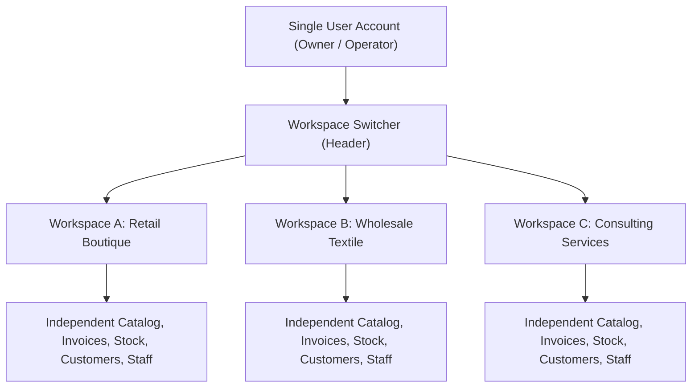
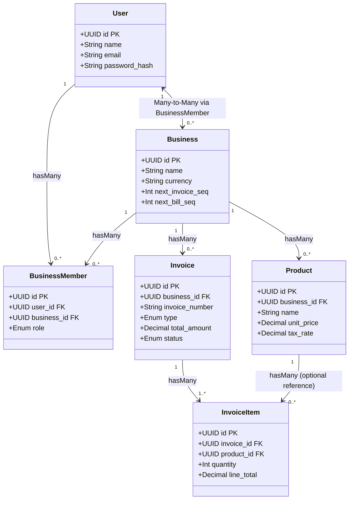
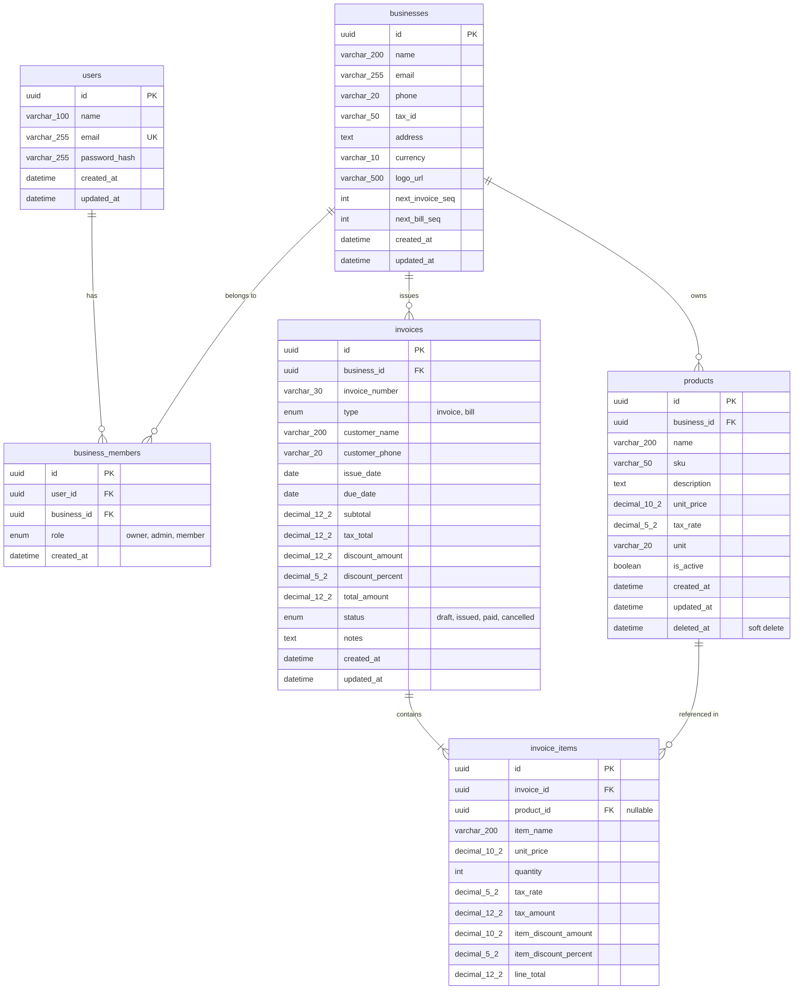
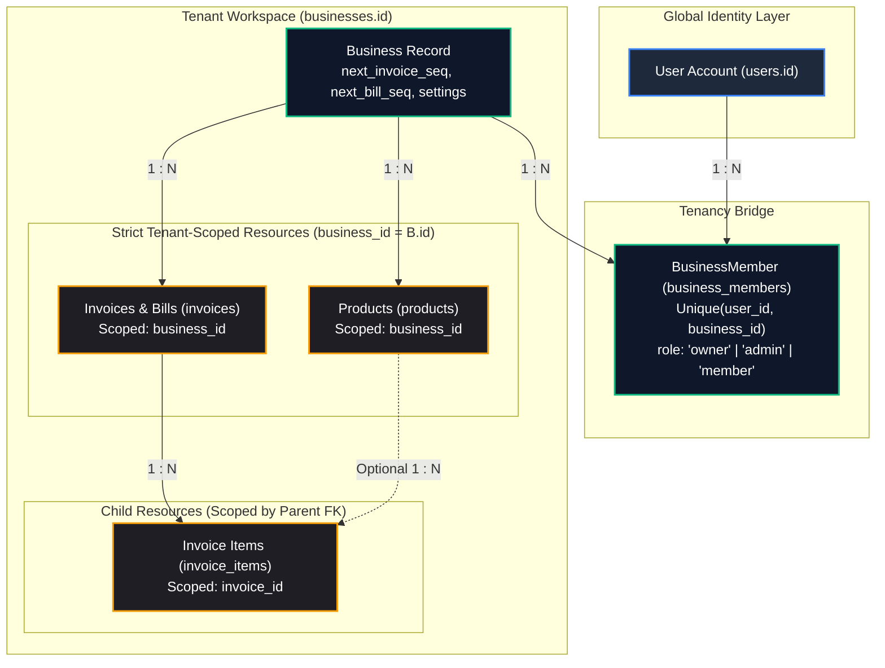
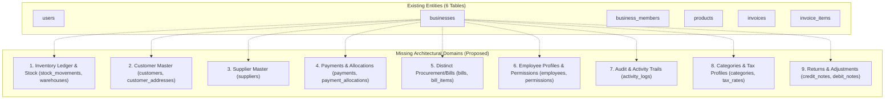
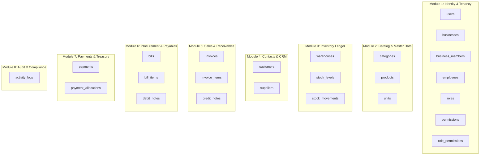
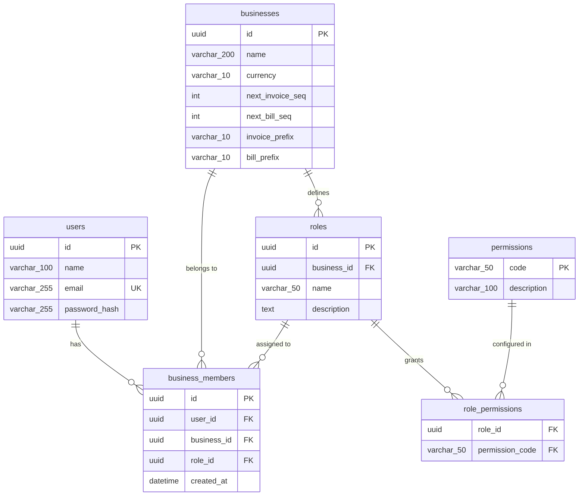
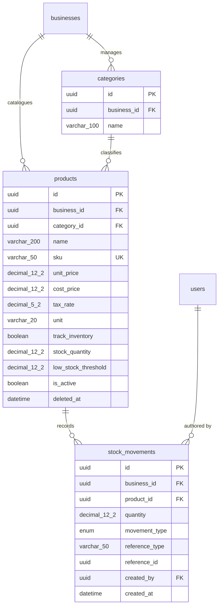
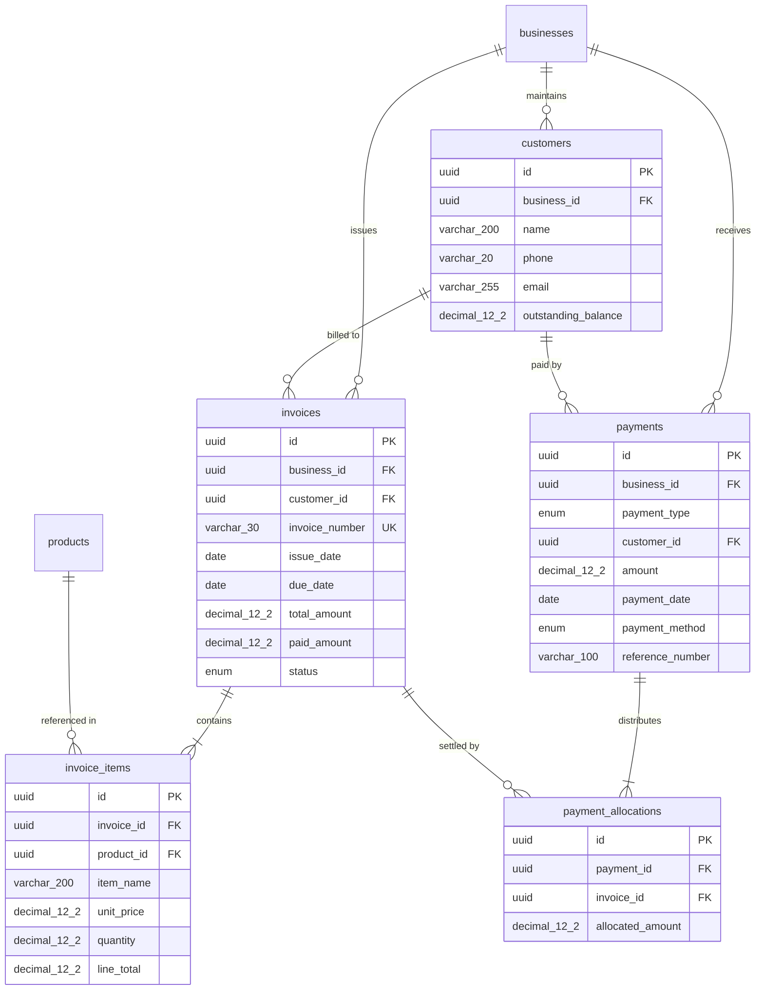
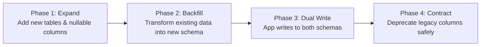

# Alturay: Comprehensive Database Audit, Business Requirements Analysis, and Future Database Architecture Report

**Document Title:** Alturay Comprehensive Database Audit & Architecture Blueprint  
**Deliverable File:** `ALTURAY_DATABASE_ARCHITECTURE_AUDIT.md`  
**Author:** Senior Database Architect, Backend Architect, Data Modeler & Systems Analyst  
**Date of Audit:** October 25, 2026  
**Target Repository:** `/Users/devyashrasela/Data/Web/Projects/Alturay`  
**Status:** Architecture Specification & Engineering Audit (Non-destructive / Planning Only)  

---

## 1. Executive Summary

**Alturay** is an emerging multi-tenant business management platform designed for small-to-medium enterprises (SMEs) to operate multiple businesses (e.g., retail, wholesale, consulting) from a unified user account. The platform's objective is to provide intuitive, fast, and multi-workspace operational management (sales, procurement, catalog, invoicing, billing, and reporting) without the bloat and complexity of legacy enterprise resource planning (ERP) suites.

### Key Audit Findings
1. **Core Tenancy Model:** Tenancy is established relationally via a many-to-many junction table (`business_members`) linking global identity accounts (`users`) to enterprise entities (`businesses`). Application-level isolation is enforced via Express middleware (`tenantMiddleware.js`), which resolves tenant identifiers from either route parameters (`:businessId`) or the `X-Business-Id` header.
2. **Current Schema Footprint:** The existing database schema consists of **exactly 6 tables**: `users`, `businesses`, `business_members`, `products`, `invoices`, and `invoice_items`.
3. **Severe Operational Gaps for Planned Capabilities:**
   - **Zero Stock Tracking:** The `products` model holds pricing and tax rates, but **no stock quantities, low-stock thresholds, or inventory movements exist**. Stock cannot be decremented, tracked, or alerted.
   - **Denormalized Contacts:** There are **no `customers` or `suppliers` tables**. Names and phone numbers are captured as ad-hoc strings directly on invoices, resulting in duplicate data, inability to track customer receivables/supplier payables over time, and zero contact history.
   - **Missing Financial Ledger & Payment Records:** Payments do not exist as database entities. "Payment" is represented solely by setting `invoices.status = 'paid'`. There is **no support for partial payments, split payments, multi-invoice settlements, payment methods, transaction references, or refunds**.
   - **Unified Invoice/Bill Storage:** Invoices (receivables) and bills (payables) share a single database table (`invoices`) distinguished by an `ENUM('invoice', 'bill')` column. While this simplifies shared sequence generation and line-item totaling, it conflates customer sales with vendor procurement.
   - **Dormant Access Control (RBAC):** Although `business_members` defines roles (`owner`, `admin`, `member`), **zero backend controllers enforce role checks**. Any member has full destructive permissions.
   - **No Activity/Audit Trail:** There are no audit log or event history tables. Notification alerts are derived on the fly by scanning for overdue unpaid invoices.
4. **Migration Feasibility:** Because existing data volume is modest and models are defined cleanly via Sequelize, the database can be evolved smoothly using an **Expand-and-Contract migration strategy** without breaking active operations.

---

## 2. Product Overview and Business Goals

Alturay targets business owners who run one or more operational entities. The platform must satisfy several key business requirements:



### 2.1 Multi-Business Workspace Isolation
- A single login must administer multiple legally distinct businesses.
- Switching workspaces must instantaneously shift the data context. Business B must never see Business A's stock, customer lists, financial metrics, or invoice sequences.

### 2.2 Flexible Business Membership & Delegated Staffing
- A business owner must be able to invite staff members (cashiers, inventory managers, accountants).
- Distinct permissions must govern module access (e.g., a cashier can create invoices but cannot view whole-business profit margins or modify tax settings).

### 2.3 Modular Operational Domains
The future database architecture must natively support:
1. **Catalog & Inventory:** SKU management, stock tracking, reorder thresholds, inventory movement logs (sales deductions, restock additions, wastage adjustments).
2. **Customer & Supplier Master Data:** Dedicated contact entities with credit balances, address books, and complete transaction histories.
3. **Sales & Invoicing:** Numbering sequences, line items, taxes, discounts, drafts, issuance, status transitions, and PDF rendering.
4. **Procurement & Vendor Bills:** Purchase bills, supplier payment obligations, and automatic stock replenishment upon receipt.
5. **Payments & Cash Flow:** Multi-payment recording against documents, partial payments, payment method tracking, and balance reconciliation.
6. **Activity & Audit Logging:** Accountability trail identifying which user altered document states, modified stock, or updated settings.

---

## 3. Repository Inspection Methodology

The investigation was conducted through non-destructive, static analysis of the complete codebase:
- **Backend Model & Association Inspection:** Inspected all files in [`server/src/models/`](file:///Users/devyashrasela/Data/Web/Projects/Alturay/server/src/models), verifying attributes, data types, indexes, hooks, and relational foreign keys.
- **Controller & Service Flow Tracing:** Examined [`server/src/controllers/`](file:///Users/devyashrasela/Data/Web/Projects/Alturay/server/src/controllers) and [`server/src/services/`](file:///Users/devyashrasela/Data/Web/Projects/Alturay/server/src/services) to determine actual SQL query construction, transaction usage, locking mechanisms, and business rule enforcement.
- **Middleware & Route Guard Audit:** Analyzed [`server/src/middlewares/authMiddleware.js`](file:///Users/devyashrasela/Data/Web/Projects/Alturay/server/src/middlewares/authMiddleware.js) and [`server/src/middlewares/tenantMiddleware.js`](file:///Users/devyashrasela/Data/Web/Projects/Alturay/server/src/middlewares/tenantMiddleware.js) to evaluate token verification and tenancy enforcement.
- **Validation Schemas:** Cross-referenced Joi schemas in [`server/src/validators/`](file:///Users/devyashrasela/Data/Web/Projects/Alturay/server/src/validators) against database nullability and constraints.
- **Frontend State & RTK Query Audit:** Inspected [`client/src/store/api/`](file:///Users/devyashrasela/Data/Web/Projects/Alturay/client/src/store/api) and UI views in [`client/src/pages/`](file:///Users/devyashrasela/Data/Web/Projects/Alturay/client/src/pages) to determine how client state maps to backend entities.
- **Evidence Verification:** Every table, constraint, and workflow documented below is paired with verified source file paths and line numbers.

---

## 4. Current Database Technology and Configuration

### 4.1 Database Configuration & Dialect
- **Database Engine:** MySQL 8.x / MariaDB compatible.
- **Database Driver:** `mysql2` (`v3.12.0`).
- **Object-Relational Mapping (ORM):** Sequelize (`v6.37.5`) with Sequelize CLI (`v6.6.2`).
- **Connection Configuration:** Loaded via [`server/src/config/database.js`](file:///Users/devyashrasela/Data/Web/Projects/Alturay/server/src/config/database.js) and [`server/src/config/index.js`](file:///Users/devyashrasela/Data/Web/Projects/Alturay/server/src/config/index.js).
- **Connection Pool:** Configured in [`server/src/models/index.js:L15-20`](file:///Users/devyashrasela/Data/Web/Projects/Alturay/server/src/models/index.js#L15-L20):
  - `max`: 10 connections
  - `min`: 2 connections
  - `acquire`: 30,000 ms
  - `idle`: 10,000 ms
- **Live Database Status:** Connection attempts during server startup targeted an external Aiven Cloud MySQL instance (`alturay-database-alturay.l.aivencloud.com`), which exited with `SequelizeHostNotFoundError: getaddrinfo ENOTFOUND`. Live schema details could not be independently queried; all analysis is based on active ORM definitions and repository source code.

### 4.2 Primary Key & Identifier Conventions
- **Identifier Strategy:** Global UUIDv4 strings across all models (`DataTypes.UUID`, `defaultValue: DataTypes.UUIDV4`).
- **Advantages:** Prevents ID enumeration attacks; allows client-side ID generation; facilitates future distributed replication.
- **Disadvantages:** 36-character string storage overhead in MySQL InnoDB; non-sequential B-Tree index fragmentation if high-volume inserts occur without UUID ordering.

### 4.3 Schema Synchronization & Migrations
- **Runtime Sync:** In development mode (`NODE_ENV === 'development'`), [`server/server.js:L14`](file:///Users/devyashrasela/Data/Web/Projects/Alturay/server/server.js#L14) invokes:
  ```javascript
  await sequelize.sync({ alter: true });
  ```
- **Migration Directory:** The directory `server/src/migrations` defined in [`.sequelizerc`](file:///Users/devyashrasela/Data/Web/Projects/Alturay/server/.sequelizerc) does **not** contain migration scripts.
- **Production Risk:** Running `sequelize.sync({ alter: true })` in production is non-deterministic and can lock tables or drop constraints unexpectedly. A formalized migration strategy using versioned scripts is required.

---

## 5. Complete Existing Table Inventory

The existing repository defines **exactly 6 tables**:

| Table Name | Business Domain | Purpose | Model File | Primary Key | Foreign Keys | Tenant Owned | Soft Delete | Current Usage |
| :--- | :--- | :--- | :--- | :--- | :--- | :---: | :---: | :--- |
| **`users`** | Identity | Global user account credentials | [`User.js`](file:///Users/devyashrasela/Data/Web/Projects/Alturay/server/src/models/User.js) | `id` (UUID) | None | No (Global) | No | Login, registration, identity |
| **`businesses`** | Tenancy | Business workspace profile & sequences | [`Business.js`](file:///Users/devyashrasela/Data/Web/Projects/Alturay/server/src/models/Business.js) | `id` (UUID) | None | Yes (Is Tenant) | No | Workspace profile, document numbering |
| **`business_members`** | Tenancy / RBAC | User-to-business membership & role | [`BusinessMember.js`](file:///Users/devyashrasela/Data/Web/Projects/Alturay/server/src/models/BusinessMember.js) | `id` (UUID) | `user_id`, `business_id` | Yes | No | Workspace access authorization |
| **`products`** | Catalog | Item/service pricing & tax catalog | [`Product.js`](file:///Users/devyashrasela/Data/Web/Projects/Alturay/server/src/models/Product.js) | `id` (UUID) | `business_id` | Yes | Yes (`deleted_at`) | Products list, invoice line picker |
| **`invoices`** | Billing | Unified sales invoices & vendor bills | [`Invoice.js`](file:///Users/devyashrasela/Data/Web/Projects/Alturay/server/src/models/Invoice.js) | `id` (UUID) | `business_id` | Yes | No | Sales & billing workflows, PDF export |
| **`invoice_items`** | Billing | Line items belonging to an invoice | [`InvoiceItem.js`](file:///Users/devyashrasela/Data/Web/Projects/Alturay/server/src/models/InvoiceItem.js) | `id` (UUID) | `invoice_id`, `product_id` | Indirect (`invoice_id`) | No | Line item price & tax calculation |

---

## 6. Detailed Existing Schema: Every Table and Field

### 6.1 Table: `users`
- **Model File:** [`server/src/models/User.js:L4-31`](file:///Users/devyashrasela/Data/Web/Projects/Alturay/server/src/models/User.js#L4-L31)
- **Table Name:** `users`
- **Options:** `timestamps: true`, `underscored: true`

| Column | Data Type | Nullable | Default | Primary Key | Foreign Key | Unique | Index | Purpose / Notes |
| :--- | :--- | :---: | :---: | :---: | :---: | :---: | :---: | :--- |
| `id` | `CHAR(36)` (UUID) | No | `UUIDV4` | Yes | No | Yes | Primary | Unique user identifier |
| `name` | `VARCHAR(100)` | No | None | No | No | No | No | User's full display name |
| `email` | `VARCHAR(255)` | No | None | No | No | Yes | Unique | Login email address (validated format) |
| `password_hash` | `VARCHAR(255)` | No | None | No | No | No | No | Bcrypt hashed password (salt factor 12) |
| `created_at` | `DATETIME` | No | Current | No | No | No | No | Account registration timestamp |
| `updated_at` | `DATETIME` | No | Current | No | No | No | No | Account modification timestamp |

---

### 6.2 Table: `businesses`
- **Model File:** [`server/src/models/Business.js:L4-56`](file:///Users/devyashrasela/Data/Web/Projects/Alturay/server/src/models/Business.js#L4-L56)
- **Table Name:** `businesses`
- **Options:** `timestamps: true`, `underscored: true`

| Column | Data Type | Nullable | Default | Primary Key | Foreign Key | Unique | Index | Purpose / Notes |
| :--- | :--- | :---: | :---: | :---: | :---: | :---: | :---: | :--- |
| `id` | `CHAR(36)` (UUID) | No | `UUIDV4` | Yes | No | Yes | Primary | Workspace business identifier |
| `name` | `VARCHAR(200)` | No | None | No | No | No | No | Legal or trading business name |
| `email` | `VARCHAR(255)` | Yes | `NULL` | No | No | No | No | Business contact email |
| `phone` | `VARCHAR(20)` | Yes | `NULL` | No | No | No | No | Business contact phone number |
| `tax_id` | `VARCHAR(50)` | Yes | `NULL` | No | No | No | No | Tax ID / GSTIN / VAT registration |
| `address` | `TEXT` | Yes | `NULL` | No | No | No | No | Registered business address |
| `currency` | `VARCHAR(10)` | No | `'INR'` | No | No | No | No | Operating currency code (e.g. INR, USD) |
| `logo_url` | `VARCHAR(500)` | Yes | `NULL` | No | No | No | No | URL to hosted brand logo image |
| `next_invoice_seq`| `INT` | No | `1` | No | No | No | No | Monotonic counter for `INV-xxx` |
| `next_bill_seq` | `INT` | No | `1` | No | No | No | No | Monotonic counter for `BILL-xxx` |
| `created_at` | `DATETIME` | No | Current | No | No | No | No | Business creation timestamp |
| `updated_at` | `DATETIME` | No | Current | No | No | No | No | Business profile update timestamp |

---

### 6.3 Table: `business_members`
- **Model File:** [`server/src/models/BusinessMember.js:L4-37`](file:///Users/devyashrasela/Data/Web/Projects/Alturay/server/src/models/BusinessMember.js#L4-L37)
- **Table Name:** `business_members`
- **Options:** `timestamps: true`, `updatedAt: false`, `underscored: true`

| Column | Data Type | Nullable | Default | Primary Key | Foreign Key | Unique | Index | Purpose / Notes |
| :--- | :--- | :---: | :---: | :---: | :---: | :---: | :---: | :--- |
| `id` | `CHAR(36)` (UUID) | No | `UUIDV4` | Yes | No | Yes | Primary | Membership record identifier |
| `user_id` | `CHAR(36)` (UUID) | No | None | No | `users.id` | Composite | `idx_user_biz` | Associated user identity |
| `business_id` | `CHAR(36)` (UUID) | No | None | No | `businesses.id` | Composite | `idx_user_biz` | Associated business workspace |
| `role` | `ENUM('owner', 'admin', 'member')` | No | `'member'` | No | No | No | No | Workspace role designation |
| `created_at` | `DATETIME` | No | Current | No | No | No | No | Join timestamp (`updatedAt` disabled) |

---

### 6.4 Table: `products`
- **Model File:** [`server/src/models/Product.js:L4-55`](file:///Users/devyashrasela/Data/Web/Projects/Alturay/server/src/models/Product.js#L4-L55)
- **Table Name:** `products`
- **Options:** `timestamps: true`, `paranoid: true` (Soft deletes via `deleted_at`), `underscored: true`

| Column | Data Type | Nullable | Default | Primary Key | Foreign Key | Unique | Index | Purpose / Notes |
| :--- | :--- | :---: | :---: | :---: | :---: | :---: | :---: | :--- |
| `id` | `CHAR(36)` (UUID) | No | `UUIDV4` | Yes | No | Yes | Primary | Product identifier |
| `business_id` | `CHAR(36)` (UUID) | No | None | No | `businesses.id` | No | No | Owning business workspace |
| `name` | `VARCHAR(200)` | No | None | No | No | No | No | Item or service catalog name |
| `sku` | `VARCHAR(50)` | Yes | `NULL` | No | No | No | No | Stock Keeping Unit code |
| `description` | `TEXT` | Yes | `NULL` | No | No | No | No | Extended product description |
| `unit_price` | `DECIMAL(10, 2)` | No | `0.00` | No | No | No | No | Default unit selling price |
| `tax_rate` | `DECIMAL(5, 2)` | No | `0.00` | No | No | No | No | Tax percentage (e.g. 18 for 18% GST) |
| `unit` | `VARCHAR(20)` | Yes | `'pcs'` | No | No | No | No | Unit of measurement (pcs, kg, hrs) |
| `is_active` | `BOOLEAN` | No | `true` | No | No | No | No | Active catalog availability toggle |
| `created_at` | `DATETIME` | No | Current | No | No | No | No | Record creation timestamp |
| `updated_at` | `DATETIME` | No | Current | No | No | No | No | Record update timestamp |
| `deleted_at` | `DATETIME` | Yes | `NULL` | No | No | No | No | Soft-delete timestamp |

---

### 6.5 Table: `invoices`
- **Model File:** [`server/src/models/Invoice.js:L4-87`](file:///Users/devyashrasela/Data/Web/Projects/Alturay/server/src/models/Invoice.js#L4-L87)
- **Table Name:** `invoices`
- **Options:** `timestamps: true`, `underscored: true`

| Column | Data Type | Nullable | Default | Primary Key | Foreign Key | Unique | Index | Purpose / Notes |
| :--- | :--- | :---: | :---: | :---: | :---: | :---: | :---: | :--- |
| `id` | `CHAR(36)` (UUID) | No | `UUIDV4` | Yes | No | Yes | Primary | Invoice identifier |
| `business_id` | `CHAR(36)` (UUID) | No | None | No | `businesses.id` | Composite | `idx_biz_invnum`| Owning business workspace |
| `invoice_number` | `VARCHAR(30)` | No | None | No | No | Composite | `idx_biz_invnum`| E.g. `INV-001` or `BILL-001` |
| `type` | `ENUM('invoice', 'bill')` | No | None | No | No | No | No | Document type discriminator |
| `customer_name` | `VARCHAR(200)` | No | None | No | No | No | No | Denormalized customer/vendor string |
| `customer_phone`| `VARCHAR(20)` | Yes | `NULL` | No | No | No | No | Contact phone number |
| `issue_date` | `DATE` | No | None | No | No | No | No | Date document was generated |
| `due_date` | `DATE` | Yes | `NULL` | No | No | No | No | Payment deadline |
| `subtotal` | `DECIMAL(12, 2)` | No | `0.00` | No | No | No | No | Net total after line discounts |
| `tax_total` | `DECIMAL(12, 2)` | No | `0.00` | No | No | No | No | Cumulative tax across all line items |
| `discount_amount`| `DECIMAL(12, 2)`| No | `0.00` | No | No | No | No | Invoice-level flat discount |
| `discount_percent`|`DECIMAL(5, 2)` | No | `0.00` | No | No | No | No | Invoice-level percentage discount |
| `total_amount` | `DECIMAL(12, 2)` | No | `0.00` | No | No | No | No | Final payable amount |
| `status` | `ENUM('draft', 'issued', 'paid', 'cancelled')` | No | `'draft'` | No | No | No | No | Document lifecycle state |
| `notes` | `TEXT` | Yes | `NULL` | No | No | No | No | Customer notes, terms, conditions |
| `created_at` | `DATETIME` | No | Current | No | No | No | No | Record creation timestamp |
| `updated_at` | `DATETIME` | No | Current | No | No | No | No | Record update timestamp |

---

### 6.6 Table: `invoice_items`
- **Model File:** [`server/src/models/InvoiceItem.js:L4-67`](file:///Users/devyashrasela/Data/Web/Projects/Alturay/server/src/models/InvoiceItem.js#L4-L67)
- **Table Name:** `invoice_items`
- **Options:** `timestamps: false`, `underscored: true`

| Column | Data Type | Nullable | Default | Primary Key | Foreign Key | Unique | Index | Purpose / Notes |
| :--- | :--- | :---: | :---: | :---: | :---: | :---: | :---: | :--- |
| `id` | `CHAR(36)` (UUID) | No | `UUIDV4` | Yes | No | Yes | Primary | Line item identifier |
| `invoice_id` | `CHAR(36)` (UUID) | No | None | No | `invoices.id` | No | No | Parent invoice reference |
| `product_id` | `CHAR(36)` (UUID) | Yes | `NULL` | No | `products.id` | No | No | Optional catalog link (null for custom items) |
| `item_name` | `VARCHAR(200)` | No | None | No | No | No | No | Snapshot of item name |
| `unit_price` | `DECIMAL(10, 2)` | No | None | No | No | No | No | Unit price at time of invoicing |
| `quantity` | `INT` | No | `1` | No | No | No | No | Billed unit quantity |
| `tax_rate` | `DECIMAL(5, 2)` | No | `0.00` | No | No | No | No | Line item tax rate percentage |
| `tax_amount` | `DECIMAL(12, 2)` | No | `0.00` | No | No | No | No | Computed tax amount for line |
| `item_discount_amount` | `DECIMAL(10, 2)` | No | `0.00` | No | No | No | No | Flat line-item discount |
| `item_discount_percent`| `DECIMAL(5, 2)` | No | `0.00` | No | No | No | No | Percentage line-item discount |
| `line_total` | `DECIMAL(12, 2)` | No | `0.00` | No | No | No | No | Final line amount after tax & discounts |

---

## 7. Existing Primary Keys, Foreign Keys, Constraints, and Indexes

### 7.1 Primary Keys
- Every existing table uses a single UUID primary key named `id`.

### 7.2 Foreign Keys and Associational Integrity
- **`business_members.user_id` $\rightarrow$ `users.id`:** Declared in Sequelize associations.
- **`business_members.business_id` $\rightarrow$ `businesses.id`:** Declared in Sequelize associations.
- **`products.business_id` $\rightarrow$ `businesses.id`:** Declared in Sequelize associations.
- **`invoices.business_id` $\rightarrow$ `businesses.id`:** Declared in Sequelize associations.
- **`invoice_items.invoice_id` $\rightarrow$ `invoices.id`:** Declared in Sequelize associations.
- **`invoice_items.product_id` $\rightarrow$ `products.id`:** Declared in Sequelize associations (`allowNull: true`).
- **Integrity Concern:** None of the Sequelize associations define explicit `onDelete: 'CASCADE'` or `onDelete: 'RESTRICT'` rules. In development sync mode, MySQL default behavior applies, which may permit orphaned records if parent records are deleted directly in the database.

### 7.3 Unique Constraints & Indexes
1. **`users.email`:** Unique constraint declared on model (`unique: true`).
2. **`business_members` Composite Index:** Unique composite index on `['user_id', 'business_id']` defined in [`BusinessMember.js:L28-33`](file:///Users/devyashrasela/Data/Web/Projects/Alturay/server/src/models/BusinessMember.js#L28-L33). Prevents duplicate memberships.
3. **`invoices` Composite Index:** Unique composite index on `['business_id', 'invoice_number']` defined in [`Invoice.js:L78-83`](file:///Users/devyashrasela/Data/Web/Projects/Alturay/server/src/models/Invoice.js#L78-L83). Guarantees that invoice numbers are unique within a business, while allowing different businesses to both have `INV-001`.
4. **Missing Performance Indexes:**
   - No index on `products.business_id` (forces table scan on catalog queries).
   - No index on `invoices.business_id` + `invoices.created_at` (slows dashboard sorting).
   - No index on `invoices.business_id` + `invoices.status` (slows status filtering).
   - No index on `invoice_items.invoice_id` (slows line item joins).

---

## 8. Existing Entity Relationships

Defined in [`server/src/models/index.js:L32-58`](file:///Users/devyashrasela/Data/Web/Projects/Alturay/server/src/models/index.js#L32-L58):



---

## 9. Existing Database ER Diagram



---

## 10. Business Ownership and Tenant Isolation Diagram



---

## 11. Existing Workflow-to-Database Mapping

### Workflow 1: User Registration
- **Files:** [`server/src/controllers/authController.js:L12-42`](file:///Users/devyashrasela/Data/Web/Projects/Alturay/server/src/controllers/authController.js#L12-L42), [`authValidator.js`](file:///Users/devyashrasela/Data/Web/Projects/Alturay/server/src/validators/authValidator.js)
- **Tables Touched:** `users` (INSERT)
- **Integrity Checks:** Joi validates email and min-8-character password. `User.findOne({ where: { email } })` checks uniqueness. Password hashed via bcrypt before write.
- **Transactions:** None (single write).

### Workflow 2: Business Creation
- **Files:** [`server/src/controllers/businessController.js:L27-47`](file:///Users/devyashrasela/Data/Web/Projects/Alturay/server/src/controllers/businessController.js#L27-L47)
- **Tables Touched:** `businesses` (INSERT), `business_members` (INSERT)
- **Fields Set:** `businesses.name`, `currency` (default INR), `next_invoice_seq = 1`, `next_bill_seq = 1`. `business_members.role = 'owner'`.
- **Integrity Concern:** **No database transaction is used.** If creating the `business_members` row fails, an orphaned business is left in the database.

### Workflow 3: Switching Between Businesses
- **Files:** [`client/src/components/layout/WorkspaceSwitcher.jsx:L72-76`](file:///Users/devyashrasela/Data/Web/Projects/Alturay/client/src/components/layout/WorkspaceSwitcher.jsx#L72-L76), [`baseApi.js:L12-20`](file:///Users/devyashrasela/Data/Web/Projects/Alturay/client/src/store/api/baseApi.js#L12-L20), [`tenantMiddleware.js:L3-46`](file:///Users/devyashrasela/Data/Web/Projects/Alturay/server/src/middlewares/tenantMiddleware.js#L3-L46)
- **Tables Touched:** `business_members` (SELECT), `businesses` (SELECT)
- **Flow:** Redux updates `activeBusinessId` and writes to `localStorage`. Subsequent calls attach `X-Business-Id`. `tenantMiddleware` executes `BusinessMember.findOne` to ensure user has access before allowing controller access.

### Workflow 4: Product Catalog CRUD
- **Files:** [`server/src/controllers/productController.js:L4-114`](file:///Users/devyashrasela/Data/Web/Projects/Alturay/server/src/controllers/productController.js#L4-L114)
- **Tables Touched:** `products` (INSERT, SELECT, UPDATE, DELETE)
- **Scoping:** Every query enforces `business_id = req.businessId`. Deletion executes a soft delete (`paranoid: true`), setting `deleted_at`.

### Workflow 5: Invoice Creation & Sequence Increment
- **Files:** [`server/src/controllers/invoiceController.js:L46-112`](file:///Users/devyashrasela/Data/Web/Projects/Alturay/server/src/controllers/invoiceController.js#L46-L112)
- **Tables Touched:** `businesses` (SELECT ... FOR UPDATE, UPDATE), `invoices` (INSERT), `invoice_items` (bulkCreate INSERT)
- **Transactions:** **Fully protected via `sequelize.transaction()` with row-level locking (`{ lock: true }`).**
- **Sequence Generation:** Reads `business.next_invoice_seq` (or `next_bill_seq`), formats string `INV-001` or `BILL-001`, writes `invoices` row, inserts line items, and increments sequence counter atomically. If any step fails, the transaction rolls back cleanly.

### Workflow 6: Updating Invoice Status
- **Files:** [`server/src/controllers/invoiceController.js:L208-226`](file:///Users/devyashrasela/Data/Web/Projects/Alturay/server/src/controllers/invoiceController.js#L208-L226)
- **Tables Touched:** `invoices` (UPDATE)
- **Validation:** Joi enforces `status IN ('draft', 'issued', 'paid', 'cancelled')`.
- **Limitation:** Status update does **not** trigger stock deduction or write any payment transaction record.

### Workflow 7: Dashboard Statistics Calculation
- **Files:** [`server/src/controllers/dashboardController.js:L14-145`](file:///Users/devyashrasela/Data/Web/Projects/Alturay/server/src/controllers/dashboardController.js#L14-L145)
- **Tables Touched:** `products` (COUNT), `invoices` (COUNT, SUM, GROUP BY), `invoice_items` (SUM, GROUP BY)
- **Aggregations:** All queries run concurrently via `Promise.all` filtered by `business_id = req.businessId`. Calculates total revenue, 6-month monthly series, status breakdowns, and top 5 items.

---

## 12. Current Database Strengths

1. **Clean Tenancy Isolation:** Tenancy is established from the ground up. Every resource table (`products`, `invoices`) possesses an indexed `business_id` foreign key.
2. **Robust Concurrency in Document Numbering:** [`invoiceController.js:L52`](file:///Users/devyashrasela/Data/Web/Projects/Alturay/server/src/controllers/invoiceController.js#L52) uses a row-level lock (`{ lock: true, transaction: t }`) during invoice creation, preventing duplicate sequence numbers under race conditions.
3. **Historical Line Item Snapshots:** The `invoice_items` table stores `item_name`, `unit_price`, and `tax_rate` as explicit values rather than joining dynamically to `products`. If a product's price changes later, past invoices remain immutable.
4. **Soft Delete on Products:** `Product` uses `paranoid: true`, preventing historical invoice references from breaking if a product is deleted from the active catalog.
5. **Precise Decimal Formatting:** All financial fields use `DECIMAL(10, 2)` or `DECIMAL(12, 2)`, avoiding floating-point rounding errors.

---

## 13. Current Database Limitations

1. **Zero Stock Tracking:** No stock quantity, warehouse location, or stock movement tracking exists.
2. **Denormalized Customer/Vendor Strings:** No contact entities exist. Customers cannot be queried by lifetime value or outstanding balance.
3. **No Payment Records:** Invoices can only be marked fully paid or unpaid; partial payments and multi-payment reconciliation are impossible.
4. **Conflated Invoices and Bills:** Invoices and bills share one table, making accounts receivable and accounts payable accounting entangled.
5. **Unenforced Roles:** All roles (`owner`, `admin`, `member`) are authorized equally in controller logic.
6. **No Audit Log:** No historical record of actions taken by users within a business.

---

## 14. Missing Entities and Business Domains

The following 9 business domains are completely missing from the existing schema:



---

## 15. Data Integrity and Security Audit

### 15.1 Tenant Boundary Analysis
- **Cross-Tenant Product Invoicing Vulnerability:**  
  When creating an invoice ([`invoiceController.js:L81`](file:///Users/devyashrasela/Data/Web/Projects/Alturay/server/src/controllers/invoiceController.js#L81)), the backend accepts `product_id` for line items **without checking if the `product_id` belongs to `req.businessId`**. A malicious user could submit a UUID of a product from a competitor's business, creating a foreign key reference across tenants.
- **Unverified Custom Item Names:**  
  Custom items can be invoiced with `product_id = null`, which is valid, but line items linked to real products must be validated against `Product.findOne({ where: { id: product_id, business_id: req.businessId } })`.

### 15.2 Orphaned Record Risk on Business Creation
In [`businessController.js:L27-47`](file:///Users/devyashrasela/Data/Web/Projects/Alturay/server/src/controllers/businessController.js#L27-L47), business creation and owner assignment occur in two separate, non-transactional database calls. If the second call fails, a business exists with no owner or members, locking the name and sequences indefinitely.

---

## 16. Query Performance and Indexing Analysis

### Missing Indexes Requiring Immediate Remediation:
1. **`products.business_id`:**  
   Currently, every catalog lookup executes `WHERE business_id = ?` without an explicit single-column index on `business_id` (it relies on table scans in development sync).
2. **`invoices (business_id, created_at)`:**  
   The dashboard recent invoice query orders by `created_at DESC` filtered by `business_id`. A composite index `(business_id, created_at DESC)` is required.
3. **`invoices (business_id, status)` & `invoices (business_id, type)`:**  
   Dashboard aggregations group by `type` and filter by `status IN ('issued', 'paid')`. A composite index `(business_id, type, status)` will optimize aggregate queries.
4. **`invoice_items.invoice_id`:**  
   Every join from `invoices` to `invoice_items` filters on `invoice_id`. An index on `invoice_id` is essential.

---

## 17. Proposed Database Architecture

The proposed database architecture organizes Alturay into **8 cohesive domain modules**:



---

## 18. Proposed Table Inventory

| # | Proposed Table Name | Domain | Purpose | Extension or New | Tenant Owned |
| :---: | :--- | :--- | :--- | :---: | :---: |
| 1 | **`users`** | Identity | Global authentication identity | Retained (Unchanged) | No |
| 2 | **`businesses`** | Tenancy | Tenant workspace & configuration | Extended | Yes |
| 3 | **`business_members`** | Tenancy / RBAC | User-to-business membership & role | Extended | Yes |
| 4 | **`roles`** | Access Control | Custom workspace roles | **New** | Yes |
| 5 | **`permissions`** | Access Control | System-defined permission keys | **New** | No (Global) |
| 6 | **`role_permissions`** | Access Control | Role-to-permission mapping | **New** | Yes |
| 7 | **`categories`** | Catalog | Product classifications | **New** | Yes |
| 8 | **`products`** | Catalog / Stock | Catalog items with stock tracking | Extended | Yes |
| 9 | **`warehouses`** | Inventory | Storage locations (default + branches) | **New** | Yes |
| 10 | **`stock_levels`** | Inventory | Cached stock quantity per warehouse | **New** | Yes |
| 11 | **`stock_movements`** | Inventory | Immutable ledger of all stock in/out | **New** | Yes |
| 12 | **`customers`** | Contacts | Dedicated customer records & balances | **New** | Yes |
| 13 | **`suppliers`** | Contacts | Dedicated vendor records & balances | **New** | Yes |
| 14 | **`invoices`** | Sales | Sales invoices (receivables) | Extended / Split | Yes |
| 15 | **`invoice_items`** | Sales | Line items for customer invoices | Extended | Yes (via Invoice) |
| 16 | **`bills`** | Procurement | Vendor bills (payables) | **New (Split)** | Yes |
| 17 | **`bill_items`** | Procurement | Line items for supplier bills | **New** | Yes (via Bill) |
| 18 | **`payments`** | Finance | Inflow & outflow payment records | **New** | Yes |
| 19 | **`payment_allocations`** | Finance | Maps payments to invoices or bills | **New** | Yes |
| 20 | **`activity_logs`** | Audit | Audit log of all business events | **New** | Yes |

---

## 19. Detailed Proposed Schema

### 19.1 Identity & Tenancy Domain

#### Table: `businesses` (Extended)
| Column | Suggested Type | Nullable | Default | Key / Constraint | Purpose |
| :--- | :--- | :---: | :---: | :---: | :--- |
| `id` | `CHAR(36)` (UUID) | No | `UUIDV4` | PK | Workspace identifier |
| `name` | `VARCHAR(200)` | No | None | None | Business legal name |
| `email` | `VARCHAR(255)` | Yes | `NULL` | None | Business email |
| `phone` | `VARCHAR(20)` | Yes | `NULL` | None | Contact phone |
| `tax_id` | `VARCHAR(50)` | Yes | `NULL` | None | GSTIN/VAT |
| `address` | `TEXT` | Yes | `NULL` | None | Physical address |
| `currency` | `VARCHAR(10)` | No | `'INR'` | None | ISO currency |
| `logo_url` | `VARCHAR(500)` | Yes | `NULL` | None | Hosted logo URL |
| `next_invoice_seq` | `INT UNSIGNED` | No | `1` | None | Invoice sequence counter |
| `next_bill_seq` | `INT UNSIGNED` | No | `1` | None | Bill sequence counter |
| `invoice_prefix` | `VARCHAR(10)` | No | `'INV'` | None | Customizable prefix (New) |
| `bill_prefix` | `VARCHAR(10)` | No | `'BILL'` | None | Customizable prefix (New) |
| `created_at` | `DATETIME` | No | Current | None | Timestamp |
| `updated_at` | `DATETIME` | No | Current | None | Timestamp |

---

### 19.2 Catalog & Inventory Domain

#### Table: `categories` (New)
| Column | Suggested Type | Nullable | Default | Key / Constraint | Purpose |
| :--- | :--- | :---: | :---: | :---: | :--- |
| `id` | `CHAR(36)` (UUID) | No | `UUIDV4` | PK | Category identifier |
| `business_id` | `CHAR(36)` (UUID) | No | None | FK $\rightarrow$ `businesses.id` | Tenant ownership |
| `name` | `VARCHAR(100)` | No | None | Unique(`business_id`, `name`) | Category name |
| `created_at` | `DATETIME` | No | Current | None | Timestamp |

#### Table: `products` (Extended)
| Column | Suggested Type | Nullable | Default | Key / Constraint | Purpose |
| :--- | :--- | :---: | :---: | :---: | :--- |
| `id` | `CHAR(36)` (UUID) | No | `UUIDV4` | PK | Product identifier |
| `business_id` | `CHAR(36)` (UUID) | No | None | FK $\rightarrow$ `businesses.id` | Tenant ownership |
| `category_id` | `CHAR(36)` (UUID) | Yes | `NULL` | FK $\rightarrow$ `categories.id` | Category link (New) |
| `name` | `VARCHAR(200)` | No | None | Index(`business_id`, `name`) | Item name |
| `sku` | `VARCHAR(50)` | Yes | `NULL` | Unique(`business_id`, `sku`)| Unique SKU per business |
| `description` | `TEXT` | Yes | `NULL` | None | Detailed description |
| `unit_price` | `DECIMAL(12, 2)`| No | `0.00` | None | Selling price |
| `cost_price` | `DECIMAL(12, 2)`| No | `0.00` | None | Purchase cost (New) |
| `tax_rate` | `DECIMAL(5, 2)` | No | `0.00` | None | Tax percentage |
| `unit` | `VARCHAR(20)` | No | `'pcs'` | None | Unit of measurement |
| `track_inventory`| `BOOLEAN` | No | `true` | None | Toggle for physical vs service (New) |
| `stock_quantity` | `DECIMAL(12, 2)`| No | `0.00` | None | Cached global stock balance (New) |
| `low_stock_threshold`| `DECIMAL(12, 2)`| No | `5.00` | None | Alert threshold (New) |
| `is_active` | `BOOLEAN` | No | `true` | None | Catalog availability |
| `created_at` | `DATETIME` | No | Current | None | Timestamp |
| `updated_at` | `DATETIME` | No | Current | None | Timestamp |
| `deleted_at` | `DATETIME` | Yes | `NULL` | None | Soft-delete timestamp |

#### Table: `stock_movements` (New Ledger Entity)
| Column | Suggested Type | Nullable | Default | Key / Constraint | Purpose |
| :--- | :--- | :---: | :---: | :---: | :--- |
| `id` | `CHAR(36)` (UUID) | No | `UUIDV4` | PK | Movement ledger identifier |
| `business_id` | `CHAR(36)` (UUID) | No | None | FK $\rightarrow$ `businesses.id` | Tenant ownership |
| `product_id` | `CHAR(36)` (UUID) | No | None | FK $\rightarrow$ `products.id` | Product altered |
| `quantity` | `DECIMAL(12, 2)`| No | None | None | Signed quantity (+10 in, -2 out) |
| `movement_type` | `ENUM('sale', 'purchase', 'adjustment', 'return', 'wastage')` | No | None | None | Reason for change |
| `reference_type`| `VARCHAR(50)` | Yes | `NULL` | None | Source table (e.g. 'invoices', 'bills') |
| `reference_id` | `CHAR(36)` (UUID) | Yes | `NULL` | None | Source document UUID |
| `notes` | `TEXT` | Yes | `NULL` | None | Adjustment reason / note |
| `created_by` | `CHAR(36)` (UUID) | No | None | FK $\rightarrow$ `users.id` | User authorizing change |
| `created_at` | `DATETIME` | No | Current | Index(`business_id`, `created_at`) | Audit timestamp |

---

### 19.3 Contacts Domain (Customers & Suppliers)

#### Table: `customers` (New)
| Column | Suggested Type | Nullable | Default | Key / Constraint | Purpose |
| :--- | :--- | :---: | :---: | :---: | :--- |
| `id` | `CHAR(36)` (UUID) | No | `UUIDV4` | PK | Customer identifier |
| `business_id` | `CHAR(36)` (UUID) | No | None | FK $\rightarrow$ `businesses.id` | Tenant ownership |
| `name` | `VARCHAR(200)` | No | None | Index(`business_id`, `name`) | Customer name / company |
| `phone` | `VARCHAR(20)` | Yes | `NULL` | Index(`business_id`, `phone`)| Contact phone number |
| `email` | `VARCHAR(255)` | Yes | `NULL` | None | Billing email |
| `tax_id` | `VARCHAR(50)` | Yes | `NULL` | None | Customer GST/VAT number |
| `billing_address`| `TEXT` | Yes | `NULL` | None | Official billing address |
| `shipping_address`|`TEXT` | Yes | `NULL` | None | Delivery address |
| `outstanding_balance`|`DECIMAL(12, 2)`| No | `0.00` | None | Current total unpaid receivables |
| `is_active` | `BOOLEAN` | No | `true` | None | Active contact toggle |
| `created_at` | `DATETIME` | No | Current | None | Timestamp |
| `updated_at` | `DATETIME` | No | Current | None | Timestamp |

#### Table: `suppliers` (New)
| Column | Suggested Type | Nullable | Default | Key / Constraint | Purpose |
| :--- | :--- | :---: | :---: | :---: | :--- |
| `id` | `CHAR(36)` (UUID) | No | `UUIDV4` | PK | Supplier identifier |
| `business_id` | `CHAR(36)` (UUID) | No | None | FK $\rightarrow$ `businesses.id` | Tenant ownership |
| `name` | `VARCHAR(200)` | No | None | Index(`business_id`, `name`) | Vendor company name |
| `phone` | `VARCHAR(20)` | Yes | `NULL` | None | Contact phone |
| `email` | `VARCHAR(255)` | Yes | `NULL` | None | Vendor email |
| `tax_id` | `VARCHAR(50)` | Yes | `NULL` | None | Vendor GSTIN/VAT |
| `address` | `TEXT` | Yes | `NULL` | None | Vendor business address |
| `outstanding_balance`|`DECIMAL(12, 2)`| No | `0.00` | None | Current total unpaid payables |
| `is_active` | `BOOLEAN` | No | `true` | None | Active vendor toggle |
| `created_at` | `DATETIME` | No | Current | None | Timestamp |
| `updated_at` | `DATETIME` | No | Current | None | Timestamp |

---

### 19.4 Sales & Billing Domain

#### Table: `invoices` (Refactored for Sales Receivables)
| Column | Suggested Type | Nullable | Default | Key / Constraint | Purpose |
| :--- | :--- | :---: | :---: | :---: | :--- |
| `id` | `CHAR(36)` (UUID) | No | `UUIDV4` | PK | Invoice identifier |
| `business_id` | `CHAR(36)` (UUID) | No | None | FK $\rightarrow$ `businesses.id` | Tenant ownership |
| `customer_id` | `CHAR(36)` (UUID) | Yes | `NULL` | FK $\rightarrow$ `customers.id` | Customer entity link |
| `invoice_number` | `VARCHAR(30)` | No | None | Unique(`business_id`, `invoice_number`) | E.g. `INV-001` |
| `customer_name_snapshot` | `VARCHAR(200)` | No | None | None | Immutable customer name |
| `customer_phone_snapshot`| `VARCHAR(20)` | Yes | `NULL` | None | Immutable phone number |
| `issue_date` | `DATE` | No | None | Index(`business_id`, `issue_date`)| Invoice issue date |
| `due_date` | `DATE` | Yes | `NULL` | Index(`business_id`, `due_date`)| Payment deadline |
| `subtotal` | `DECIMAL(12, 2)` | No | `0.00` | None | Total after item discounts |
| `tax_total` | `DECIMAL(12, 2)` | No | `0.00` | None | Cumulative tax |
| `discount_amount`| `DECIMAL(12, 2)` | No | `0.00` | None | Flat invoice discount |
| `discount_percent`|`DECIMAL(5, 2)` | No | `0.00` | None | Percent invoice discount |
| `total_amount` | `DECIMAL(12, 2)` | No | `0.00` | None | Gross payable amount |
| `paid_amount` | `DECIMAL(12, 2)` | No | `0.00` | None | Cumulative payments received (New) |
| `status` | `ENUM('draft', 'issued', 'partially_paid', 'paid', 'cancelled')` | No | `'draft'` | Index(`business_id`, `status`)| Lifecycle state |
| `notes` | `TEXT` | Yes | `NULL` | None | Terms & payment info |
| `created_by` | `CHAR(36)` (UUID) | Yes | `NULL` | FK $\rightarrow$ `users.id` | User who created invoice (New) |
| `created_at` | `DATETIME` | No | Current | None | Timestamp |
| `updated_at` | `DATETIME` | No | Current | None | Timestamp |

#### Table: `invoice_items` (Retained & Extended)
| Column | Suggested Type | Nullable | Default | Key / Constraint | Purpose |
| :--- | :--- | :---: | :---: | :---: | :--- |
| `id` | `CHAR(36)` (UUID) | No | `UUIDV4` | PK | Line item identifier |
| `invoice_id` | `CHAR(36)` (UUID) | No | None | FK $\rightarrow$ `invoices.id` ON DELETE CASCADE | Parent invoice |
| `product_id` | `CHAR(36)` (UUID) | Yes | `NULL` | FK $\rightarrow$ `products.id` ON DELETE SET NULL | Catalog product |
| `item_name` | `VARCHAR(200)` | No | None | None | Historical name snapshot |
| `unit_price` | `DECIMAL(12, 2)` | No | None | None | Historical price snapshot |
| `quantity` | `DECIMAL(12, 2)` | No | `1.00` | None | Billed quantity |
| `tax_rate` | `DECIMAL(5, 2)` | No | `0.00` | None | Historical tax rate % |
| `tax_amount` | `DECIMAL(12, 2)` | No | `0.00` | None | Line tax amount |
| `item_discount_amount` | `DECIMAL(12, 2)` | No | `0.00` | None | Flat line discount |
| `item_discount_percent`| `DECIMAL(5, 2)` | No | `0.00` | None | Percent line discount |
| `line_total` | `DECIMAL(12, 2)` | No | None | None | Final net line amount |

---

### 19.5 Payments & Financial Records Domain

#### Table: `payments` (New)
| Column | Suggested Type | Nullable | Default | Key / Constraint | Purpose |
| :--- | :--- | :---: | :---: | :---: | :--- |
| `id` | `CHAR(36)` (UUID) | No | `UUIDV4` | PK | Payment transaction identifier |
| `business_id` | `CHAR(36)` (UUID) | No | None | FK $\rightarrow$ `businesses.id` | Tenant ownership |
| `payment_type` | `ENUM('inflow', 'outflow')` | No | None | None | Inflow (Customer) vs Outflow (Vendor) |
| `customer_id` | `CHAR(36)` (UUID) | Yes | `NULL` | FK $\rightarrow$ `customers.id` | Optional customer link |
| `supplier_id` | `CHAR(36)` (UUID) | Yes | `NULL` | FK $\rightarrow$ `suppliers.id` | Optional supplier link |
| `amount` | `DECIMAL(12, 2)` | No | None | None | Total transaction amount |
| `payment_date`| `DATE` | No | None | Index(`business_id`, `payment_date`) | Settlement date |
| `payment_method`|`ENUM('cash', 'bank_transfer', 'upi', 'card', 'cheque', 'other')`| No | `'cash'` | None | Payment instrument |
| `reference_number`|`VARCHAR(100)` | Yes | `NULL` | None | Bank reference / UPI UTR / Cheque # |
| `notes` | `TEXT` | Yes | `NULL` | None | Transaction remarks |
| `created_by` | `CHAR(36)` (UUID) | No | None | FK $\rightarrow$ `users.id` | User recording transaction |
| `created_at` | `DATETIME` | No | Current | None | Timestamp |

#### Table: `payment_allocations` (New)
| Column | Suggested Type | Nullable | Default | Key / Constraint | Purpose |
| :--- | :--- | :---: | :---: | :---: | :--- |
| `id` | `CHAR(36)` (UUID) | No | `UUIDV4` | PK | Allocation identifier |
| `payment_id` | `CHAR(36)` (UUID) | No | None | FK $\rightarrow$ `payments.id` ON DELETE CASCADE | Parent payment transaction |
| `invoice_id` | `CHAR(36)` (UUID) | Yes | `NULL` | FK $\rightarrow$ `invoices.id` ON DELETE CASCADE | Target customer invoice |
| `bill_id` | `CHAR(36)` (UUID) | Yes | `NULL` | FK $\rightarrow$ `bills.id` ON DELETE CASCADE | Target supplier bill |
| `allocated_amount`|`DECIMAL(12, 2)`| No | None | None | Amount applied to document |
| `created_at` | `DATETIME` | No | Current | None | Timestamp |

---

### 19.6 Audit Logging Domain

#### Table: `activity_logs` (New)
| Column | Suggested Type | Nullable | Default | Key / Constraint | Purpose |
| :--- | :--- | :---: | :---: | :---: | :--- |
| `id` | `CHAR(36)` (UUID) | No | `UUIDV4` | PK | Event identifier |
| `business_id` | `CHAR(36)` (UUID) | No | None | FK $\rightarrow$ `businesses.id` | Tenant ownership |
| `user_id` | `CHAR(36)` (UUID) | Yes | `NULL` | FK $\rightarrow$ `users.id` ON DELETE SET NULL | User who initiated action |
| `action` | `VARCHAR(50)` | No | None | None | E.g. `invoice.create`, `stock.adjust` |
| `entity_type` | `VARCHAR(50)` | No | None | None | Target entity (`invoice`, `product`) |
| `entity_id` | `CHAR(36)` (UUID) | Yes | `NULL` | None | Target entity UUID |
| `details` | `JSON` | Yes | `NULL` | None | State before/after or payload |
| `created_at` | `DATETIME` | No | Current | Index(`business_id`, `created_at`)| Event timestamp |

---

## 20. Proposed ER Diagrams

### Diagram 1: Core Tenancy & Access Control


### Diagram 2: Catalog & Inventory Ledger


### Diagram 3: Sales, Customers, and Payments


---

## 21. Major Architectural Decisions and Trade-offs

### Decision 1: Dedicated Customer and Supplier Tables vs. Unified Party Model
- **Alternative Considered:** A single `parties` table with an `is_customer` / `is_supplier` flag.
- **Recommended Approach:** **Separate `customers` and `suppliers` tables.**
- **Reasoning:** In small businesses, customers and vendors have radically different lifecycles, credit conditions, and compliance requirements. Separate tables guarantee strict referential integrity, clear indexing, and avoid polluting customer lookup lists with suppliers.

### Decision 2: Separating Invoices and Bills into Distinct Tables
- **Current Implementation:** Unified `invoices` table with `type: 'invoice' | 'bill'`.
- **Recommended Approach:** **Split into `invoices` (Sales/Receivables) and `bills` (Procurement/Payables).**
- **Reasoning:** Sales invoices link to customers, generate output tax, and decrement inventory. Vendor bills link to suppliers, capture input tax credit, and increment inventory. Keeping them in one table leads to nullable foreign keys (`customer_id` vs `supplier_id`) and confusing status semantics (an issued customer invoice is an asset; an issued vendor bill is a liability).

### Decision 3: Direct Stock Quantity Column vs. Pure Ledger Calculations
- **Alternative Considered:** Storing only `stock_movements` and computing stock via `SUM(quantity)` dynamically.
- **Recommended Approach:** **Hybrid approach.** Maintain `products.stock_quantity` as a cached balance updated within a database transaction whenever an immutable record is inserted into `stock_movements`.
- **Reasoning:** Computing stock on the fly via `SUM()` across millions of rows causes severe dashboard performance degradation. The cached column provides sub-millisecond catalog reads, while the `stock_movements` ledger guarantees full auditability.

---

## 22. Business Rules and Unresolved Product Decisions

### Confirmed Business Rules (Existing Code)
1. **Invoice Numbering Concurrency:** Invoice numbers must be sequential per business and allocated under row-level database locks.
2. **Draft Immutability:** Only invoices in `'draft'` state can have their line items edited ([`invoiceController.js:L154`](file:///Users/devyashrasela/Data/Web/Projects/Alturay/server/src/controllers/invoiceController.js#L154)).
3. **Item Pricing Snapshots:** Invoice items retain the price and tax rate captured at creation time; changing the product catalog price does not alter existing invoices.

### Product Decision Register

| # | Question / Decision | Why It Matters | Available Options | Recommended Default | Requires Owner Approval |
| :- | :--- | :--- | :--- | :--- | :---: |
| 1 | **When is stock deducted?** | Determines whether inventory is locked at draft stage or upon delivery. | A) On Draft creation<br/>B) On 'issued' status<br/>C) On 'paid' status | **Option B: Deduct upon changing status to 'issued'.** | **Yes** |
| 2 | **Can stock be negative?** | Some retail shops sell items before logging purchase bills. | A) Strict error if stock < 0<br/>B) Allow negative stock with warning | **Option B: Allow negative stock with visual alerts.** | **Yes** |
| 3 | **Partial Payments Representation** | Invoices frequently receive installments over time. | A) Binary status (unpaid/paid)<br/>B) `partially_paid` state with `paid_amount` | **Option B: Add `partially_paid` status.** | **Yes** |
| 4 | **Customer Auto-Creation** | Creating invoices currently accepts ad-hoc text names. | A) Require picking from customer master<br/>B) Allow typing name and auto-create customer | **Option B: Auto-create customer record if new.** | **Yes** |
| 5 | **Financial Visibility for 'Members'** | Cashiers/clerks should not see whole-business net profit. | A) Universal access<br/>B) RBAC restriction on revenue metrics | **Option B: Restrict dashboard revenue to Owner/Admin.** | **Yes** |

---

## 23. Existing Data Migration Strategy

To evolve the active database without causing downtime or corrupting historical data, we apply the **Expand-and-Contract Migration Pattern**:



### Step-by-Step Backfill Procedures:
1. **Migrate Customers from Historical Invoices:**
   ```sql
   INSERT INTO customers (id, business_id, name, phone, created_at, updated_at)
   SELECT UUID(), business_id, customer_name, customer_phone, MIN(created_at), NOW()
   FROM invoices
   WHERE type = 'invoice' AND customer_name IS NOT NULL
   GROUP BY business_id, customer_name, customer_phone;
   ```
2. **Backfill `invoices.customer_id`:**
   ```sql
   UPDATE invoices i
   JOIN customers c ON c.business_id = i.business_id AND c.name = i.customer_name
   SET i.customer_id = c.id
   WHERE i.type = 'invoice';
   ```
3. **Split Vendor Bills into `bills` Table:**
   Extract all rows where `type = 'bill'` from `invoices` into the new `bills` table and associate line items to `bill_items`.

---

## 24. Migration Risks and Rollback Procedures

| Risk | Impact | Preventative Measure | Rollback Strategy |
| :--- | :--- | :--- | :--- |
| **Data Truncation During Backfill** | Data loss on customer strings | Use `VARCHAR(200)` matching original `invoices.customer_name` length. | Restore from snapshot taken prior to script execution. |
| **Lock Contention on Invoices** | Application downtime | Run `ALTER TABLE` during maintenance window or use online schema change (`gh-ost` / `pt-online-schema-change`). | Cancel DDL execution; original table untouched. |
| **Orphaned Custom Invoice Items** | Broken line item foreign keys | Ensure `invoice_items.product_id` explicitly retains `allowNull: true`. | Script validation check before adding constraints. |

---

## 25. Prioritized Implementation Roadmap

### Priority 0: Safety & Tenant Integrity (Week 1)
- [ ] Add explicit composite indexes: `products(business_id)`, `invoices(business_id, created_at)`.
- [ ] Wrap business creation in a database transaction to prevent orphaned business entities.
- [ ] Validate `product_id` in invoice item creation to ensure it belongs to `req.businessId`.

### Priority 1: Contact Masters & Inventory Foundation (Weeks 2–3)
- [ ] Create `customers` and `suppliers` tables.
- [ ] Add `stock_quantity`, `low_stock_threshold`, and `cost_price` to `products`.
- [ ] Create `stock_movements` ledger table.
- [ ] Backfill existing customer strings into `customers` table.

### Priority 2: Payments & Document Splitting (Weeks 4–5)
- [ ] Create `payments` and `payment_allocations` tables.
- [ ] Support `partially_paid` invoice status and record payments with transaction numbers.
- [ ] Create separate `bills` and `bill_items` tables for procurement.

### Priority 3: Role-Based Access Control & Audit Trails (Weeks 6–7)
- [ ] Create `roles`, `permissions`, and `role_permissions` tables.
- [ ] Enforce permission checks in backend controllers (`requirePermission('invoices.create')`).
- [ ] Create `activity_logs` table and log key events asynchronously.

---

## 26. Testing and Validation Plan

### 26.1 Automated Schema Tests
- Verify foreign key cascades (`DELETE FROM invoices` removes corresponding `invoice_items`).
- Verify uniqueness constraints (`business_id, invoice_number` rejects duplicate sequences).
- Verify soft delete behavior (`Product.destroy()` sets `deleted_at`, excludes from default queries).

### 26.2 Multi-Tenant Isolation Tests
```javascript
// Test Scenario: Tenant Isolation Verification
test('Tenant A cannot invoice Tenant B product', async () => {
  const productB = await createProduct({ business_id: tenantB.id });
  const res = await request(app)
    .post(`/api/businesses/${tenantA.id}/invoices`)
    .set('Authorization', `Bearer ${tokenA}`)
    .send({ items: [{ product_id: productB.id, quantity: 1, unit_price: 10 }] });

  expect(res.status).toBe(400);
  expect(res.body.error.message).toMatch(/Product not found in this business/);
});
```

### 26.3 Concurrency & Race Condition Tests
- Simulate 20 concurrent requests creating invoices simultaneously for the same business; assert zero duplicate sequence numbers and contiguous sequence increments.

---

## 27. Final Recommendations

### Summary Comparison Table

| Domain | Current State | Major Limitation | Recommended Change | Priority |
| :--- | :--- | :--- | :--- | :---: |
| **Catalog** | Simple name & price table | No stock tracking, low stock alerts, or cost price | Add `stock_quantity`, `low_stock_threshold`, `cost_price` | **P1** |
| **Inventory** | Non-existent | Cannot track inventory movements or deduce stock | Create `stock_movements` immutable ledger table | **P1** |
| **Contacts** | Ad-hoc strings on invoices | Duplication, no customer balance, no contact history | Create dedicated `customers` and `suppliers` tables | **P1** |
| **Invoicing** | Invoices and bills share 1 table | Conflates receivables and payables; no partial payments | Split `bills` into dedicated table; add `partially_paid` | **P2** |
| **Payments** | String toggle (`status = 'paid'`) | Cannot record partial payments, dates, or payment methods | Create `payments` and `payment_allocations` tables | **P2** |
| **Security** | RBAC unverified in controllers | Members have full destructive permissions | Introduce permission middleware checking `req.memberRole` | **P0** |
| **Audit** | Derived client-side notifications | No event trail or accountability log | Create `activity_logs` table | **P3** |

---

### Schema Change Matrix

| Table Name | Current Structure | Proposed Change | Architectural Rationale | Migration Risk |
| :--- | :--- | :--- | :--- | :--- |
| **`businesses`** | Profile & sequence counters | Add `invoice_prefix`, `bill_prefix` | Allows tenant custom document numbering | Very Low (Nullable/Default) |
| **`products`** | Name, SKU, price, tax | Add `stock_quantity`, `low_stock_threshold`, `cost_price`, `category_id` | Enables inventory tracking & alerts | Low (Defaults provided) |
| **`customers`** | Non-existent (Text fields) | Create new table | Normalizes customer data & enables receivables | Low (Backfilled from invoices) |
| **`suppliers`** | Non-existent (Text fields) | Create new table | Normalizes vendor data & enables payables | Low (Backfilled from bills) |
| **`invoices`** | Combined sales and bills | Refactor into dedicated customer invoice entity | Cleanses domain semantics & foreign keys | Medium (Requires backfill) |
| **`bills`** | Stored in `invoices` table | Split into dedicated procurement entity | Accurately models vendor liabilities | Medium (Data extraction) |
| **`stock_movements`**| Non-existent | Create new table | Auditable inventory ledger | Very Low (New table) |
| **`payments`** | Non-existent | Create new table | Supports real financial settlement records | Very Low (New table) |

---

## 28. Appendix: File Paths, Code References, and Evidence

### Core Database Models
- [`server/src/models/index.js:L32-58`](file:///Users/devyashrasela/Data/Web/Projects/Alturay/server/src/models/index.js#L32-L58): Model definitions and relationship bindings.
- [`server/src/models/User.js:L4-31`](file:///Users/devyashrasela/Data/Web/Projects/Alturay/server/src/models/User.js#L4-L31): User model schema.
- [`server/src/models/Business.js:L4-56`](file:///Users/devyashrasela/Data/Web/Projects/Alturay/server/src/models/Business.js#L4-L56): Business model schema with `next_invoice_seq` and `next_bill_seq`.
- [`server/src/models/BusinessMember.js:L4-37`](file:///Users/devyashrasela/Data/Web/Projects/Alturay/server/src/models/BusinessMember.js#L4-L37): Membership junction table and composite uniqueness index.
- [`server/src/models/Product.js:L4-55`](file:///Users/devyashrasela/Data/Web/Projects/Alturay/server/src/models/Product.js#L4-L55): Product catalog model with `paranoid: true`.
- [`server/src/models/Invoice.js:L4-87`](file:///Users/devyashrasela/Data/Web/Projects/Alturay/server/src/models/Invoice.js#L4-L87): Unified invoice model with `type: 'invoice' | 'bill'`.
- [`server/src/models/InvoiceItem.js:L4-67`](file:///Users/devyashrasela/Data/Web/Projects/Alturay/server/src/models/InvoiceItem.js#L4-L67): Line item calculation snapshots.

### Controllers & Middlewares
- [`server/src/middlewares/tenantMiddleware.js:L3-46`](file:///Users/devyashrasela/Data/Web/Projects/Alturay/server/src/middlewares/tenantMiddleware.js#L3-L46): Multi-tenant verification middleware.
- [`server/src/controllers/invoiceController.js:L46-112`](file:///Users/devyashrasela/Data/Web/Projects/Alturay/server/src/controllers/invoiceController.js#L46-L112): Atomic row-locked invoice numbering and creation.
- [`server/src/controllers/businessController.js:L27-47`](file:///Users/devyashrasela/Data/Web/Projects/Alturay/server/src/controllers/businessController.js#L27-L47): Business creation without transaction wrapper (audit finding).
- [`server/src/controllers/dashboardController.js:L14-145`](file:///Users/devyashrasela/Data/Web/Projects/Alturay/server/src/controllers/dashboardController.js#L14-L145): Multi-metric aggregation queries.
- [`server/src/services/invoiceCalculator.js:L5-48`](file:///Users/devyashrasela/Data/Web/Projects/Alturay/server/src/services/invoiceCalculator.js#L5-L48): Server-side invoice mathematical totaling service.
